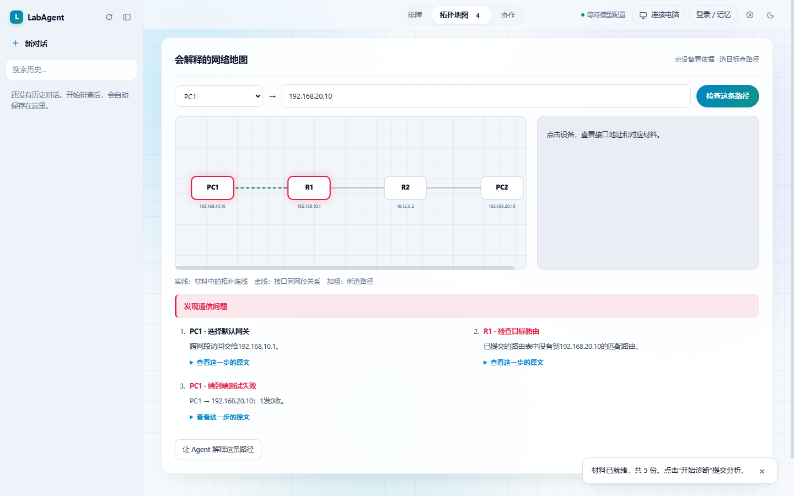

# LabAgent 如何用实验材料指导网络排障

在计算机网络实验里，学生可能已经知道 PC1 无法访问 PC2，却还要在拓扑、路由表、邻居状态和终端日志之间来回切换，才能判断下一步该查哪里。我们开发了 LabAgent，把故障材料、原文证据、修改后的输出和实验报告放在同一个会话里。

## 用一个 OSPF 案例说明

在 B 组的 FRRouting 隔离实验中，R2 的互联接口划入了 Area 1，R1 侧对应接口在 Area 0。故障阶段，两端直连正常，PC1 和 PC2 的端到端 Ping 双向均为 1 发 0 收。R2 互联接口恢复到 Area 0 后，两个方向均为 5 发 5 收，OSPF 邻居达到 Full，双方主路由表均出现远端网段的 OSPF 路由。这个案例同时核对了连通性与协议来源。 [脱敏实验材料](https://github.com/Red-hj/labagent/tree/e5180b70c55ccb305de1324fb444736492b5558b/data/team_cases/lab_02/map_materials)

## 智能体怎样选检查

网站将本轮材料、实验目标和会话状态交给部署在华为云 AgentArts Runtime 的工作流。运行时使用官方 Python SDK 封装 LangGraph，DeepSeek Flash 根据问题选择读取原文、检索资料、检查路径或核对实验目标。程序用原文位置校验引用，并依据当前观测判断每个目标是否完成。证据不足时，工作流会保留待查问题，提示补充对应设备的输出。

课程资料库支持导入 Markdown 和纯文本，按章节建立索引，用 BM25 查找候选片段，并保留资料版本和原文位置。连接实验电脑后，可通过 MCP 或内置设备接入器读取输出，加入同一轮材料。小组可把设备检查分给队友，再用带版本的共享材料复测。 [运行时入口与构建流程](https://github.com/Red-hj/labagent/blob/main/agentarts_app.py) · [镜像构建](https://github.com/Red-hj/labagent/blob/main/.github/workflows/agentarts-image.yml)

## 怎样体验

1. 在排障页上传拓扑、配置和故障输出，写明要核对的连通性与协议要求。
2. 提交诊断，展开「本轮材料与依据」核对引用。也可以打开拓扑地图，查看从源设备到目标地址的路径。
3. 修改实验配置后，上传修复后的同名日志并核对新结果。逐项检查达标情况，然后保存实验报告。

线上演示站供团队联调，访问需要团队口令。启动说明与可复现实验材料见项目仓库。 [LabAgent 演示站](https://labagent-15yh.onrender.com/) · [项目源码与使用说明](https://github.com/Red-hj/labagent)

西南石油大学 S1mple 团队。黄泓钧负责引擎与平台，付雨航负责实验数据与评测，赵亦康负责界面联调与比赛展示。
