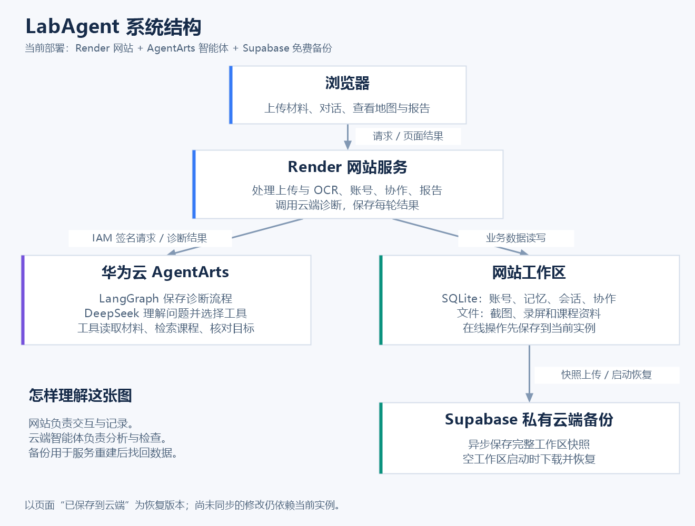

# LabAgent 功能与实现说明

更新：2026-11-19。对应 **v0.19.7 / AgentArts 运行时 v8**；按当前代码及本轮发布验证核对。

LabAgent 是围绕实验材料开展持续排查的工具：读取截图、配置、日志和实验说明，检索课程资料，调用检查工具，提出修改与补证步骤，再根据新输出核对实验是否完成。

第一次接触项目、还没学过计算机网络，可以先读[零基础使用说明](零基础使用说明.md)，按里面的自带示例体验完整流程。

当前版本已包含新版登录／注册窗口、密码显示切换、个人记忆管理，以及简化后的按钮。维护人员查请求字段可直接看[接口说明](接口说明.md)。

## 1. 项目整体怎样运行



图中三件事可以这样理解：**网站收材料和展示结果；云端智能体分析材料并调用检查工具；工作区和云端备份保存数据。** 图片随文档保存在 `docs/assets`，无需 Mermaid 插件。单独转发文档时请同时带上该图片文件夹。

纯文字流程：

```text
你上传材料 → 网站整理材料 → AgentArts 中的模型与工具分析 → 网站展示诊断
你补充复测 → 沿同一对话重新核对 → 保存记录与导出报告
网站工作区 → 异步备份到 Supabase → 服务重建后恢复已保存版本
```

| 部分 | 当前实现 | 主要作用 |
| --- | --- | --- |
| 页面 | 原生 HTML、CSS、JavaScript | 对话、资料库、引用、地图、协作和记忆管理 |
| 网站服务 | Python 标准库 `ThreadingHTTPServer` | 接口、上传、访问控制、业务记录、进度和报告 |
| 智能体编排 | LangGraph + SQLite checkpoint | 保存诊断流程状态，等待补充材料后继续 |
| 模型 | DeepSeek API | 理解材料、提出假设、调用工具、解释检查结果 |
| 云端承载 | Huawei AgentArts + ARM64 Docker 镜像 | 运行智能体，通过专用 IAM 凭据供网站调用 |
| 知识检索 | 自实现 BM25 与故障标签匹配 | 从课程资料中找相关原文片段 |
| 图像与视频 | RapidOCR、ONNX Runtime、OpenCV | 识别截图文字、抽取录屏文字与时间位置 |
| 数据保存 | SQLite + 本地媒体文件 + Supabase 快照 | 在线读写及跨部署恢复 |

当前模型能力来自 API；项目自行实现了工具、编排、引用校验、目标核对、记忆与协作等业务逻辑。已有微调种子数据，尚未训练或部署微调权重，微调按团队安排留到复赛。

## 2. 从上传到完成实验：一次诊断的内部过程

1. **整理输入**：将文字、配置文件、OCR 结果等整理成材料集合；给材料分配来源编号，保留原文行号。用户的问题、实验要求和运行输出分别记录。
2. **恢复上下文**：根据会话编号取得上轮材料、结果和交流记录；个人诊断再按账号选取相关记忆。共享诊断不带入个人记忆。
3. **选择检查**：模型通过工具调用读取指定材料、检索课程资料、比较前后材料、查看网络路径，或核对 Ping、路由及实验目标。
4. **核对依据**：检查工具参数、引用来源及原文匹配；涉及运行输出时核对其与当前配置的绑定关系，避免用旧输出证明新配置已经生效。
5. **形成回复**：输出当前判断、材料依据、下一步操作和需要补充的证据。课程片段提供参考知识，设备实际地址与参数要来自本轮材料。
6. **等待复测**：用户继续提问或提交新输出，沿同一会话更新材料与结论；保存每轮输入和结果，供历史展示与报告使用。

这里有两种诊断路径：日常对话采用开放材料排查；专业工作台还提供结构化网络实验检查，按拓扑、设备配置和链路逐项执行规则工具。两者共用材料、知识检索、结果记录等组件。

主要代码：[`investigation.py`](../labagent/investigation.py)、[`workflow.py`](../labagent/workflow.py)、[`material_service.py`](../labagent/material_service.py)、[`engine.py`](../labagent/engine.py)。

## 3. 各项功能怎样实现

### 3.1 材料诊断与多轮对话

- 支持粘贴文字，上传配置、日志、实验说明，结合截图和录屏识别结果分析。
- 开放排查的工具包括读取原文、检索参考资料、比较材料、核对 Ping、分析实验目标和网络路径等。
- LangGraph 将诊断和等待补证组织成状态图，并用 SQLite checkpoint 保存状态；会话编号用于关联后续追问。
- 每轮完整输入与结果另存业务数据库。模型侧保留最近若干轮交流，历史页面仍可展示完整已保存轮次，避免长历史全部塞进模型上下文。
- 返回状态区分“用户反馈已恢复”和“提交的原始观测核对通过”。模型提出的原因也保留假设与依据关系。

主要代码：[`investigation.py`](../labagent/investigation.py)、[`workflow.py`](../labagent/workflow.py)、[`session_state.py`](../labagent/session_state.py)。

### 3.2 截图、录屏与原文引用

- 截图通过粘贴、拖拽或上传进入媒体处理队列，OCR 在独立工作进程中运行，识别结果可手动修正。
- 保存文字及其图像位置，使诊断引用能够打开原图并高亮对应区域。
- 录屏抽取画面并识别文字，保留时间信息；操作历史解析设备提示符、命令、报错与重试，关键步骤可跳转视频。
- 文本材料引用包含来源编号、行号和逐字原文。引用检查要求内容确实出现在已读取材料中。
- 视频识别受画面质量、采样和 OCR 精度影响，关键配置仍可由用户修正或补交终端文本。

主要代码：[`recordings.py`](../labagent/recordings.py)、[`extract_recording.py`](../scripts/extract_recording.py)、[`operation_history.py`](../labagent/operation_history.py)。

### 3.3 课程知识库与 RAG

RAG 的作用是让模型回答时查阅团队导入的课程资料，提供与本次问题相关的知识和原文出处。例如，排查 OSPF 时检索区域、邻接与路由发布的说明，再结合实际设备输出判断原因。

当前流程是：

```text
导入资料及来源、版本、范围
  → 按章节边界切分，长段默认约600字符
  → 保留文档编号、片段编号、字符位置和行号
  → 对问题分词，过滤通用问句词，保留协议名
  → BM25评分，并考虑故障标签
  → 正文或故障标签命中优先于仅标题命中
  → 默认返回最多3个候选片段
  → 模型结合当前实验材料回答，引用可跳转原文
```

- 英文与数字按词处理，中文主要使用相邻双字片段；对 IS-IS / ISIS 等协议名有专门保护。
- 页面区分“有候选参考”“仅标题匹配”“无匹配”。检索命中只说明词面相关，是否足以回答仍需阅读原文。
- 课程资料提供通用知识；当前设备的区域号、接口地址和故障状态来自实际配置与运行记录。
- 资料随本次请求传入 AgentArts，确保云端诊断使用网站所选资料范围。
- **生产环境目前使用 BM25，尚未启用向量数据库或语义检索。** 语义与混合检索已有离线对照，是否采用由独立评测决定。

主要代码：[`knowledge.py`](../labagent/knowledge.py)、[`course-knowledge.js`](../web/course-knowledge.js)。详细用法见[知识库说明](知识库使用与接口.md)。

### 3.4 个人账号与用户记忆

记忆按个人账号隔离，分为三类：**常见问题、排查偏好、实验环境**。例如“经常遇到 OSPF 邻接问题”“希望先解释原理”“实验使用华为 VRP”。

网站团队访问口令是测试站的入口；个人账号用于识别用户、关联个人新对话和记忆。华为云 IAM 凭据由服务器调用运行时使用，Supabase 服务端密钥用于保存备份，均不作为用户的网页登录密码。本地与公开站是不同服务端，账号和历史默认各自保存。

- 用户可以手工添加、编辑、删除、清空记忆，也可以关闭记忆功能。
- 在符合条件的个人诊断后，系统将问题主题保存为常见问题；同一会话只累计一次，归一化后同名主题累加出现次数。
- 自动记录主要保存问题主题及提示语，未将整段聊天自动总结成“正确修复方案”；表达不同的相似问题也未做语义聚类。
- 新诊断按问题词面关联、记忆类型与出现次数选取最多6条记忆，用作回复背景。
- 偏好与环境支持持续使用；常见问题需要与当前问题相关。历史经验仍需结合本轮材料重新核对。
- 共享诊断不携带个人记忆。新建个人会话有账号归属，原团队共享记录沿用原共享范围。
- 密码采用带盐的 PBKDF2-SHA256 摘要保存；登录令牌单独管理，备份不保留可继续使用的登录令牌。
- v0.19.4 的登录与注册共用原有账号接口，通过前端状态切换标题、昵称和记忆选项。提交时锁定表单并显示进度，失败后恢复输入；成功后进入“我的记忆”。密码可显示／隐藏，关闭窗口会清空输入并恢复隐藏状态；注册成功后默认回到登录模式。

主要代码：[`personal.py`](../labagent/personal.py)、[`personal-memory.js`](../web/personal-memory.js)。

### 3.5 历史对话与删除

- 按会话聚合所有已保存轮次，转换成用户／助手的对话形式，可搜索、恢复并继续排查。
- 顶栏小按钮与 Ctrl+B（macOS 也支持 Command+B）切换历史栏；桌面保存折叠偏好，窄屏使用可关闭抽屉。
- 数据来自服务端 SQLite 中的 `attempts`，每轮包括会话编号、时间、输入和结果。
- 删除单个对话时清理对应业务轮次、网页工作流 checkpoint 和会话归属等关联记录。
- 对话、媒体和个人记忆有各自的数据结构；删除对话不等于同时清空所有记忆、独立媒体或旧备份。记忆可在记忆面板单独管理。
- 列表、详情、追问、导出和删除均检查资源归属。个人新对话按账号访问；旧团队记录保留原共享范围，协作记录按邀请与成员关系访问。

主要代码：[`store.py`](../labagent/store.py)、[`conversations.py`](../labagent/conversations.py)、[`session-history.js`](../web/session-history.js)。

### 3.6 实验目标核对与修复对照

- 将实验要求拆成可以分别检查的目标，包括 Ping 连通性、路由来源和配置要求。
- Ping 工具读取实际收发包数；路由工具解析提交的路由输出，按最长前缀等规则核对目标地址的选路依据。
- 现有解析覆盖相应华为 VRP、FRR 及 Linux 主路由表输出格式；未知协议不直接归为静态路由。
- 配置、邻接、路由和连通性分别核对，避免把“Ping 成功”直接当作 OSPF 实验完成。
- 修复对照读取已有 FRRouting 实采记录，用同一组目标比较故障、静态路由修复和 OSPF 修复，并展示配置差异与原始输出。

典型展示：备用静态路由可恢复 Ping，但 OSPF 来源和配置要求仍未通过；修复区域后，邻接与协议目标也通过。

主要代码：[`experiment_goals.py`](../labagent/experiment_goals.py)、[`runtime_parser.py`](../labagent/runtime_parser.py)、[`connectivity.py`](../labagent/connectivity.py)、[`repair_lab.py`](../labagent/repair_lab.py)。

### 3.7 “实验记录”入口（原“复测与回放”）

日常复测在对话旁点击“补充材料 / 核对新结果”，沿同一会话更新诊断与实验目标。“实验记录”是结果区域中与“对话与诊断”并列的页签，用于查看**修复前后发生了什么，以及当时操作了什么**。内容按材料出现：

| 内容 | 输入与处理 | 页面展示 |
| --- | --- | --- |
| 修复方案实际对照 | 读取结构化 FRRouting 实验运行记录，按同一组目标重新计算各阶段结果 | 各阶段满足目标数、逐项检查、修改命令、配置差异和实际检查依据 |
| 操作过程回放 | 从带设备提示符的终端日志或录屏 OCR 文本提取命令、视图、报错和后续重试 | 关键操作、完整时间线、原文定位；有配套录屏和时间信息时可跳转画面 |

操作解析由规则工具完成，结果含原文引用；“分析这一步”会把选中的操作交给当前诊断继续解释。回放示例载入后直接打开该页签，可点击“播放回放”；点击操作时间点定位并尝试播放，浏览器限制自动播放时提示手动播放。加载失败显示重试入口。录屏时间来自采样画面中文字的出现时刻，精度受采样和 OCR 影响；“终端已返回”表示观察到后续提示符，实际配置是否生效仍由新配置和运行输出核对。

**日常复测与该页签有关，但入口不同**：用户在同一对话补充修改后的配置、Ping 等输出，点击“核对新结果”，更新的是诊断与实验目标。普通材料不会自动生成结构化的多方案对照卡片；这些卡片需要对应格式的实验运行记录。只有终端文本时可定位原文，视频播放器需要配套录屏。

前端根据是否有修复对照、操作事件或录屏显示内容，没有时显示添加材料的提示。页签旁数字统计当前有内容的两类区域，不是测试次数或目标通过数。

主要代码：[`student.js`](../web/student.js) 中的 `renderRepairComparisons`、`renderOperationHistory`、`locateOperation`，以及 [`network-room.js`](../web/network-room.js) 中的 `resultsAvailable`；后端为 [`repair_lab.py`](../labagent/repair_lab.py)、[`operation_history.py`](../labagent/operation_history.py)、[`recordings.py`](../labagent/recordings.py)。

### 3.8 网络地图与团队协作

- 网络地图从提交材料解析设备、接口、地址和链路线索，组织网络关系；路径解释逐步检查网关、ARP、直连网段和路由，并附原文依据。
- 用户点击设备可查看材料或创建检查任务。地图反映材料中可得到的信息，缺失链路仍需补充材料。
- 邀请链接打开共享实验，集中保存材料、诊断会话、任务和事件记录。
- 提交带操作者与版本号；同名文件被他人更新时检测版本冲突，用户可选择版本或提交合并结果。

主要代码：[`network_map.py`](../labagent/network_map.py)、[`rooms.py`](../labagent/rooms.py)、[`network-room.js`](../web/network-room.js)。

### 3.9 交互反馈与报告

- Enter 发送、Shift+Enter 换行；提交后立即显示用户消息，失败时恢复草稿并支持重试。
- 网站通过逐行 JSON 流返回处理进度和最终结果，前端读取响应流展示进展。云调用期间显示连接、恢复和接收等实际阶段；不等同于模型逐字输出。
- 报告从保存的会话生成，包含最终状态、实验目标、材料引用、修改过程及协作记录。
- 页面和报告复用结果数据，减少展示状态与导出内容不一致的情况。
- 示例载入锁定重复操作，材料预览分别处理时间线和修复对照的失败；切换排查后丢弃旧请求返回。长对话保留独立滚动，滚到边缘后将滚轮传给页面。
- v0.19.6 将首轮和追问统一为消息内反馈：先显示用户消息，收到服务端进度后标记已发送；等待气泡呈现当前真实阶段、耗时与心跳等待提示。详细进度默认收起，失败在原消息重发；等待时可写下一条草稿，完成后保留草稿与上翻阅读位置。
- v0.19.4 统一使用轻边框次按钮和单色主按钮，去掉之前控件上的厚重玻璃渐变。登录窗口保持独立表单层次，数据说明按需展开；窄屏调整窗口宽度、最大高度和输入字号，保留键盘焦点样式及 Esc 关闭。

主要代码：[`server.py`](../labagent/server.py)、[`progress.py`](../labagent/progress.py)、[`report.py`](../labagent/report.py)、[`student.js`](../web/student.js)。

## 4. 数据究竟存在哪里

数据目录由 `LABAGENT_DATA_DIR` 指定，必须位于项目 `runtime` 内；未设置时默认使用 `runtime`。当前线上按 `runtime/persistent` 配置。

| 数据 | 当前工作区位置或结构 | 用途 |
| --- | --- | --- |
| 对话与每轮结果 | `sessions.sqlite3` / `attempts` | 历史恢复、继续诊断、报告 |
| 账号与记忆 | 同一数据库的 `personal_*` 表 | 登录、记忆、资源归属 |
| 共享实验 | 同一数据库的 `rooms` 表 | 材料版本、任务、协作记录 |
| 网页工作流状态 | 默认 `workflow-sessions.sqlite3` | 网站按 `workflow-<业务数据库文件名>` 命名；云诊断另由运行时处理 |
| 截图与录屏 | `recordings/<媒体编号>/` | 原文件、识别文本、画面位置与处理状态 |
| 导入课程资料 | 启用数据目录时的 `course_notes/*.json` | 来源、版本、范围及正文 |
| 云端备份 | Supabase 私有 `labagent-workspace` 存储空间 | 上述工作区的可恢复快照 |

浏览器负责展示和请求；账号、记忆和已保存历史以服务器记录为准。同一服务端换设备登录，可继续读取个人数据。

### 免费持久化的工作方式

1. 在线业务先写入 Render 实例上的 SQLite 和文件。
2. 后台每5秒观察变化；数据静置至少5秒后尝试生成工作区快照，上传到 Supabase 私有存储。
3. 大快照分片上传，完成后更新云端当前版本；用版本比较避免旧实例覆盖新版本，并保留近期备份。
4. 新实例以空工作区启动时，先下载、校验并恢复云端快照，再提供服务。本地和云端版本冲突时停止自动覆盖。
5. 页面显示待保存、保存中、已保存、错误或冲突。**显示“已保存到云端”后的版本可以跨部署恢复**；尚未同步的修改仍有丢失窗口。

因此，Supabase 在这里承载的是**私有快照及其版本元数据**，当前业务数据库仍是 SQLite。重要演示前可另下载工作区 ZIP；全站备份包含账号与记忆，需要维护口令，恢复后重新登录。

快照保存业务数据库、课程资料和媒体文件，不直接打包独立的 LangGraph checkpoint 数据库。诊断上下文可从已保存的业务轮次补回；AgentArts 空闲后的恢复也使用上轮网页输入与结果。模型密钥、云调用凭据和本地 `.env` 不包含在工作区 ZIP 中，重建运行环境时由维护人员另行配置。

主要代码：[`storage.py`](../labagent/storage.py)、[`cloud_storage.py`](../labagent/cloud_storage.py)、[`workspace_archive.py`](../labagent/workspace_archive.py)。

## 5. AgentArts 云端接入与空闲恢复

网站通过 `AgentArtsClient` 发送 IAM AK/SK 签名请求，专用凭据保存在服务端。请求包含当前材料、所选课程资料、实验要求和适用的个人记忆；云运行时调用 LangGraph、模型与工具，返回结构化诊断结果。

平台会话与网站会话分别记录。接近平台空闲期限或最长会话期限时，网站创建新的平台会话，并携带上轮输入、诊断和交流记录恢复上下文。平台明确返回会话不存在时，也有对应恢复路径。

普通 HTTP 500 或超时不直接重放诊断，避免第一次请求已经执行、重试又重复调用。云端还会回传资料和记忆接入标记，网站据此检查运行时是否支持本轮功能。

当前公开站已使用原有 AgentArts 运行时 v8。维护方向是沿现有资源更新镜像、排查真实案例，保持免费部署方案。

`GET /api/health` 中，`version` 表示网站版本，`diagnosis_backend` 表示当前选择 `local` 还是 `agentarts`，`diagnosis_configured` 表示对应调用配置是否就绪。网站版本与运行时版本分别维护；只改页面样式时可以更新 Render，沿用原 AgentArts 运行时。

主要代码：[`cloud_workflow.py`](../labagent/cloud_workflow.py)、[`agentarts_client.py`](../labagent/agentarts_client.py)、[`agentarts_runtime.py`](../labagent/agentarts_runtime.py)、[`agentarts_app.py`](../agentarts_app.py)。

## 6. 当前已验证与初赛剩余工作

已有真实网站验证覆盖截图识别、DeepSeek 诊断、课程检索与原文引用、多轮追问、个人记忆、报告和云端保存；重启后登录、历史与记忆恢复、原会话继续也已验证。FRRouting 实采材料用于故障／修复目标对照。

v0.19.6 见 [PR #53](https://github.com/Red-hj/labagent/pull/53)：5组前端检查与 GitHub 自动回归通过。隔离浏览器覆盖慢回复、断线、消息内重发及草稿保留；公开站同一会话两轮 AgentArts/DeepSeek 对话均正常结束，真实等待状态与新草稿保留已核对，原账号、记忆、历史及媒体数量保留，云端保存正常。地图黑框样式补修 [PR #51](https://github.com/Red-hj/labagent/pull/51) 同时保留。

v0.19.5 见 [PR #49](https://github.com/Red-hj/labagent/pull/49)：380项后端回归375通过、5项按环境跳过，4组前端检查及 GitHub 自动回归通过。本地浏览器验证了回放播放／跳转／重载、两页协作和长对话滚轮；公开站确认回放从指定时刻播放、历史栏折叠、签名 Cookie 媒体分段认证，原账号、记忆与历史保留，云端保存正常。

v0.19.4 已通过3组前端回归、16项账号／记忆检查及 GitHub 自动回归；桌面和375px检查了登录、注册、记忆保存、密码切换、错误反馈与 Esc 关闭。公开站页面文件与发布代码一致，发布后的原账号、记忆、历史及工作区数量保留，云端保存正常。改动见 [PR #45](https://github.com/Red-hj/labagent/pull/45)，发布记录见 [PR #46](https://github.com/Red-hj/labagent/pull/46)。

v0.19.3 最终 CI 共377项检查，371项通过、6项按环境或平台跳过；12道公开示例的 Top-3 排序保持不变。新增自编无关问句检查改善了检索噪声表现。**这些回归结果不等同于独立题集成绩**。队友现已按原资料与标注复评两套24题：混合语言与中文的 Top-3 分别为7/19、16/19，10道资料不足题仍全部返回候选；详细条件见[固定题集复评](知识库使用与接口.md#v0193-固定题集复评)。后续重点是检索误差、资料不足判断及诊断对照。

初赛接下来重点是：

- **付雨航**：补齐真实课堂／华为 VRP 案例与故障、修改、复测证据，交叉复核标注、分析固定题集误差并整理诊断对照。
- **黄泓钧**：分析评测误差、修复联调问题、维护云端和备份，整理架构与验证结果。
- **赵亦康**：真实案例桌面／手机验收，完成正式 Word、PPT、三分钟视频和分享稿。
- **全队**：用同一真实案例完成演示，核对提交入口要求和截止时间，固定版本并备份。

现阶段先完成评测与提交材料；微调和更精细的功能扩展按计划留到复赛。最新进度统一维护在[开发任务](后续开发.md)，接口细节见[接口说明](接口说明.md)。

## 7. 对外讲解时可以怎样概括

> LabAgent 将实验排查组织成一个持续对话过程：先读取截图、配置和日志，再检索课程资料、调用网络检查工具，给出可定位原文的解释与修改步骤。用户补交复测输出后，系统继续核对连通性、协议和配置目标，并把过程保存成报告。个人记忆提供排查背景，团队协作支持分工补证，AgentArts 承载云端智能体运行。

技术上的重点是**材料依据、工具检查、多轮复测与实验目标相连**。模型负责理解与组织，课程库提供知识，工具核对实际输出，账号记忆和工作区保存让下一次排查可以继续使用已有信息。
