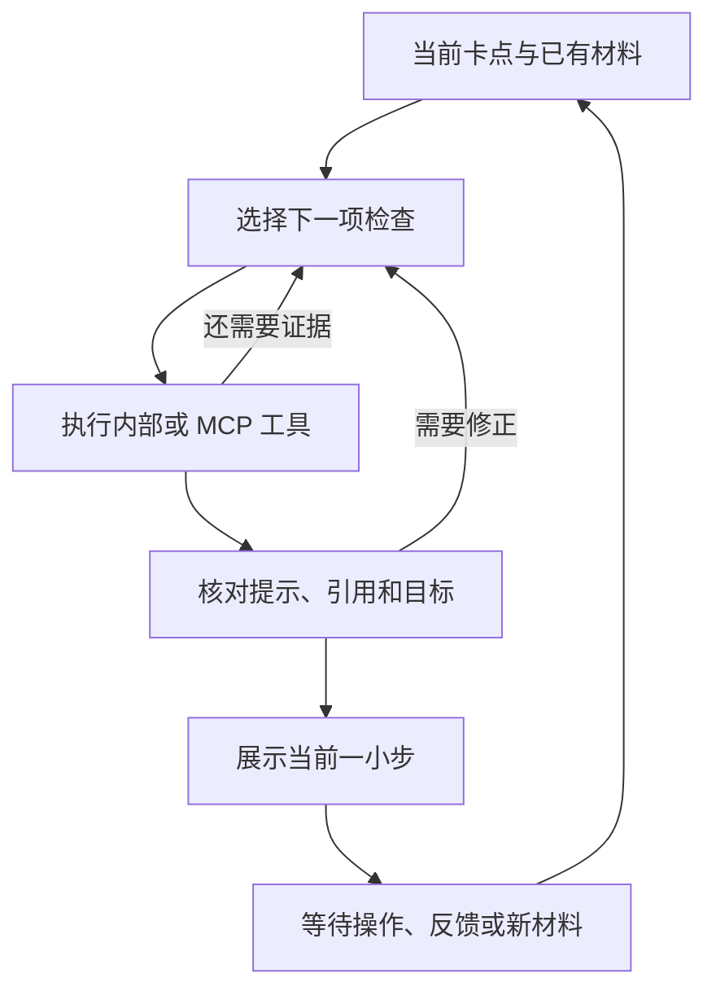

# LabAgent 接口与云端接入说明

更新：2026-11-19。网站 v0.19.7，诊断后端为 AgentArts 运行时 v8；各节版本号表示接口引入或扩展版本。使用步骤见[零基础使用说明](零基础使用说明.md)，架构见[功能与实现说明](功能与实现说明.md)。

v0.19.5：团队 Basic 认证通过后签发有效期12小时的 `labagent_team` 签名 Cookie（HttpOnly、SameSite=Strict，公开站 Secure），供同站视频分段请求等继续认证；修改团队口令使原签名失效。未通过认证的 API 返回 JSON 401 / `team_sign_in_required`，不发送 Basic challenge，避免后台请求连续弹框；访问网页入口仍使用原团队认证。过期个人 Cookie 会被清除，课程试查、材料预览及协作操作继续按原共享范围工作，个人记忆、私人会话和媒体仍检查身份与资源归属。

`GET /api/health` 的 `version` 是网站版本，`diagnosis_backend` 为 `local` 或 `agentarts`，`diagnosis_configured` 表示所选后端的调用配置是否就绪。兼容字段 `mode:local_rules` 不能单独用来判断公开站实际调用哪个诊断后端。

## 个人账号与记忆（v0.19）

- `POST /api/account/register`：`username/password/display_name?/memory_enabled?`；用户名3～32位，密码10～128字。`POST /api/account/login` 接收用户名和密码。返回公开账号资料，以 HttpOnly、SameSite=Strict Cookie 登录；线上另设 Secure，30天有效。密码采用独立盐与 PBKDF2-SHA256 600000轮，数据库只存登录令牌的哈希。
- `GET /api/account` 返回 `user` 或 null；`POST /api/account/logout` 撤销当前登录。现有团队访问口令仍作为测试站入口。
- `GET /api/memories` 返回自己的 `enabled/memories`；`POST /api/account/memory` 接收布尔值 `enabled`。
- `POST /api/memories` 接收 `kind:issue|preference|environment`、`title`（120字）、`content`（600字），可带 `id` 修改；每人最多100条。`DELETE /api/memories/{id}` 删除自己的单条，`DELETE /api/memories` 清空。删除记忆不删除已有对话及其当时参考的内容。
- 个人诊断成功返回时按问题主题累积次数，同一会话只计一次，演示、失败和共享排查不自动记忆。关闭后不注入或自动记录。服务器忽略客户端伪造的 `personal_memory`，仅选择当前账号最多6条相关历史问题及偏好、环境；记忆不作为本轮可引用材料。结果 `memory_used` 列出本轮参考标题。
- 登录后新建对话与上传媒体绑定账号，列表、详情、导出、删除和追问均检查归属；旧团队记录保留共享范围。协作室通过 `X-LabAgent-Room` 或媒体 URL 的 `room` 参数携带邀请编号，参与的登录账号可在历史中继续访问。共享诊断不调用个人记忆。

账号、记忆、归属和会话共用 `runtime/sessions.sqlite3`，设置 `LABAGENT_DATA_DIR` 后位于该目录。全站备份包含个人资料及密码哈希，不导出登录令牌，恢复后重新登录；有个人账号时必须配置独立的 `LABAGENT_MAINTENANCE_PASSWORD`，请求备份/恢复时在 `X-LabAgent-Maintenance` 提供口令。维护人员应使用独立的随机 ASCII 口令并妥善保管备份。跨部署保存可接入下述免费云端持久化。

AgentArts 接口携带不含账号标识的 `personal_memory`，运行时返回 `personal_memory_applied:true`；非空记忆遇到旧镜像会提示更新。每轮传入当前快照（关闭时为 `[]`），防止延续旧设置。公开站与运行时 v8 已接通这套流程，后续更换镜像仍需保留此能力。

v0.19.4 仅调整登录/注册和记忆面板的前端布局及交互，账号接口保持兼容。提交中锁定表单，密码可见性由前端切换；关闭窗口清空密码，登录失败后恢复输入。团队网站入口认证与个人 Cookie 认证分别处理，本地与公开站的账号不自动同步。

## 网络地图与团队协作（v0.16）

- `POST /api/network/inspect`：`{"materials":{"R1.cfg":"正文"},"source":"R1","target":"10.0.0.2"}`。source/target可省略；返回nodes、links、pings、targets，指定路径时增加explanation。节点包含接口、默认网关、运行路由与逐行引用；links.kind区分declared文字拓扑与subnet同网段关系。路径步骤区分configured、observed、passed、failed、needs_evidence，端到端passed来自对应源设备的实际Ping统计。
- Agent工具`explain_network_path(source,target)`复用同一地图和逐跳检查，返回的引用纳入本轮已读取证据。
- `POST /api/rooms`：`{"name":"网络实验","actor":"姓名"}`创建共享实验；`GET /api/rooms/{id}`读取材料、版本、成员、任务、活动与共享诊断会话。复用原有团队访问口令。
- `POST /api/rooms/{id}`：公共字段actor、member_id，action取join/materials/task/complete。materials用patches数组，每项name、content、base_revision；content=null移除材料。base_revision按单份材料版本检查，冲突返回HTTP409与code=room_conflict，整个提交回滚。不同文件允许并行合并；versions保留已删除文件的版本序号。question只在改动时提交，并附base_question。
- task包含title、assignee；complete包含task_id并切换完成状态。recordings保留截图/录屏编号，原媒体接口不变。
- 诊断请求可增加room_id、room_revision、room_actor；服务端读取共享材料快照，沿用团队最新session_id。同一协作室串行诊断。诊断期间材料更新时，旧结果仍保存于会话历史，但不会替换共享室当前结论；页面按版本标明上次分析。
- `GET /api/challenges/new`生成轻量网关练习；`POST /api/challenges/check`接收id与从0开始的choice，返回correct和reply。

共享实验保存在会话数据库rooms表。网页每4秒检查更新，存在本地草稿时保留草稿并提示合并。同文件冲突可展开查看双方全文并选择；诊断、报告导出与原接口继续兼容。

## 实际修复对照（v0.15）

- `POST /api/repair-labs/inspect`接收`{"materials":{"run.json":"完整JSON正文"}}`，返回comparisons。每个修复运行记录包含kind=labagent_repair_run、schema_version=1、run_id、environment、共同goals和phases；phases第一项为baseline，其余为独立候选，observations中保存各设备配置、FRR路由JSON、邻居JSON和Ping原文。
- 程序按goals重新检查所有阶段，不采用导入的passed/status声明。路由按最长前缀选取selected且installed的实际路由；Ping要求完整收发统计；配置要求读取实际running-config。结果含phases[].checks/changes/commands、passed_count/total与recommended。
- `compare_repair_candidates(source_id)`是Agent的新工具，返回重新核对的结果、配置差异及可引用的source_evidence。导入的独立候选输出不混入check_submitted_pings。仅包含运行记录的对照请求完成后，status为comparison_complete，LangGraph结束本轮；继续追问仍使用同一会话。
- `GET /api/demos/repair_comparison`提供本项目实际FRR运行记录。首页示例选择“修复对照：实际运行两种方案”，可直接展示对照卡片并让Agent分析；报告与刷新恢复保留repair_comparisons。
- `GET /api/demos/ospf_shutdown_measured` 提供 R2 互联接口关闭与修复实测。`interface_admin_up` 目标从 `observations[设备].interfaces[接口]` 的 `ip link show` 原文读取 `UP` 标记，判断管理启用状态。
- `GET /api/demos/ospf_backup_measured` 提供区域失配但备用静态路由维持双向 Ping 的实测；首页“Ping 通了，OSPF 还没好”重新检查3/7→7/7目标，实际路由来源与连通性分别展示。
- 实际执行入口：在具有Docker的Linux中以sudo运行`scripts/run_repair_lab.py`，或在GitHub Actions手动运行“Run FRR repair comparison”。环境和候选命令由data/lab/frr_three_routers.json定义；产物在runtime/repair-lab，逐条执行日志和原始观测一并保存。网页负责读取运行记录、核对与讲解，实际重跑通过该执行入口进行。

## 截图输入（v0.14）

复用`POST /api/recordings`上传原始PNG/JPG/JPEG/WebP字节流，`X-Recording-Name`仍为URL编码文件名；单张20MB以内。返回`kind:image`、`id`、状态和`image_url`。后台做EXIF方向归一化与本地OCR，任务查询及刷新恢复沿用现有机制。

`GET /api/recordings/{id}`在ready时返回`transcript`、`material_name`、`width`、`height`和`regions`。每个region含1起始的`line`、完整识别`text`、`box:[x1,y1,x2,y2]`与confidence；同一可见行的OCR分块按横向合并。`GET /api/recordings/{id}/image`返回方向归一化的JPEG预览，与文字框坐标一致；原始上传保留在项目runtime中。媒体文件沿用团队认证和private/no-store缓存。

页面将识别文字放入configs，截图编号放入recordings；可混合文本与视频，最多10份截图、5份录屏，总材料最多20份。截图来源kind为screenshot_ocr；引用对应识别文字行，并可定位原图。用户修正文字后诊断使用新正文，只有引用仍逐字匹配原识别行时才高亮文字框。截图没有时间戳时按行号显示操作。

Ping核对按材料和设备提示符的顺序选择同设备、同目标的最新输出块，旧输出在`superseded_pings`中保留。当前记录增加`test_device`表示识别到的源设备，`device`仍为引用材料名；其他设备的失败记录继续参与核对。无法识别源设备的不同截图各自保留，不合并为一台设备。实验目标和Ping工具复用相同的设备归属规则。

## 实验过程回溯与录屏（v0.13）

- `POST /api/operations/inspect`：JSON请求`{"materials":{"操作.log":"正文"}}`，直接返回操作时间线，支持导入后即时预览。
- `POST /api/recordings`：原始视频字节流，`X-Recording-Name`为URL编码的文件名，Content-Length最多80MB。支持mp4/webm/mov/mkv，返回HTTP202和录屏编号、queued状态、video_url。识别任务在子进程运行，同一服务串行处理录屏。
- `GET /api/recordings/{id}`：返回queued/processing/ready/error、progress和message；ready时包含transcript、material_name、duration。识别完成的文字作为普通材料进入诊断，保留视频编号供页面恢复。
- `GET /api/recordings/{id}/video`：返回原视频，支持单段Range和后缀Range，以HTTP206响应定位播放。沿用现有团队认证。
- `GET /api/demos/operation_history`提供配套合成日志和实验要求；`/api/demos/operation_history/video`提供对应15秒演示视频。

诊断输入增加`recordings`（最多15个32位截图/录屏编号），页面会自动填写。`result.operation_history`保存events、event_count、error_count、unresolved_error_count、first_issue_id/focus_id、devices、changes和latest_changes。事件列表最多保留 400 步，优先保留关键报错和可定位的重试，其余从靠后的操作选取，显示时沿用材料顺序。总数统计和录屏离线评分使用完整解析结果。事件含id、源文件/行、seconds、设备、实际视图、命令、状态、原文和响应依据；状态issued表示命令已输入，returned表示后续同设备提示符已出现，error表示匹配到明确CLI报错。相同设备和命令在后续获得终端返回时，旧报错标记recovered；配置变化记录以CLI返回为依据，后续配置和运行输出继续由原有工具核对。

模型新增`inspect_operation_timeline`工具，并可在submit_hypotheses中用`operation_focus`选择工具返回的事件id。终端回溯和报错识别由程序执行，模型结合当前配置和实验目标解释影响。报告包含相同的时间线和原文依据。

录屏使用项目内RapidOCR与OpenCV按0.5秒抽样，文字变化时执行CPU识别；滚动画面按末端文本衔接，避免将旧报错插入后续命令。时间为文字首次在采样画面中出现的时刻。任务文件、关键帧、模型缓存和识别文字均放在runtime内；录屏URL与诊断会话沿用当前服务的数据保留方式。

同一画面行内的 OCR 文字按列合并。终端回溯能识别 FRRouting 的 `% Unknown command`，并将 `O>*` 等已选路由行保留为命令输出。滚屏切换时用可见的短命令辅助定位新行，保留后续真正重试。

可用独立标注核对任意授权片段。将视频和标注放到项目 `runtime/`，安装 `requirements-replay.txt` 后运行以下命令。

```powershell
python -X utf8 scripts/verify_replay.py --video runtime/ospf-wrong-view.webm --annotations runtime/ospf-wrong-view-annotations.json --output runtime/replay-pilot-check
```

标注 JSON 的 `events` 中每项含 `id`、`device`、`view`、`command`、`seconds`、`status`，发生重试时在原报错上填写 `retry_to`。`seconds` 表示命令首次可见时间，评分按 0.5 秒容差核对。同一设备重复输入同一命令时，优先按先后顺序配出最多的容差内时间点，再以总时间误差最小的配对为准。脚本保存 OCR 结果、操作时间线和 `scores.json`，按命令、视图、状态、时间与重试分别记录。未配对事件可用于人工检查重复或未标注操作。

有同段的 UTF-8 原始终端日志时，给上面的命令增加 `--terminal-log runtime/ospf-wrong-view.log`。脚本用同一份标注按设备、命令和先后顺序配对，另存 `terminal-log-scores.json`，列出命令命中、视图、状态、重试及未配对数量。视频时间评分在 `scores.json` 中查看。

## 实验目标与主动检查（v0.12）

开放排查新增两个实际工具，沿用材料入口、流式接口、LangGraph会话和AgentArts SDK。

- `check_experiment_goals`：首次接收`goals`，每项包含`id/title/kind/device/target/expected/instruction`。`instruction` 可只填本轮已读要求的 `source_id` 与 `line`，程序补全原文。提供 `quote` 时仍核对完整原文行。同一行明确写出的多项目标可以引用同一行。支持reachability（目的IP）、route_protocol（设备、目的地址或网段、要求协议）、config_contains/config_absent（设备、命令前缀）、ospf_interface_area（设备、接口名、要求区号）。实验说明同时写出两端设备、共用接口与区域时，分别核对两台设备；缺一端或只有接口名时不会判该端通过。后续传空对象继续核对全部已保存目标；新编号可补充要求，旧编号保持原参数。问题说明以`question:initial`进入可引用材料清单，作为要求来源。
- `plan_diagnostic_checks`：接收带本轮引用的候选原因状态（active/supported/ruled_out）和候选检查。每项检查包含设备、命令、用途、1～5的采集成本及各原因下的预期结果标签。程序按可区分的原因对数/成本排序，再按覆盖数与成本处理并列；unknown和已排除原因不计入区分数。返回selected和排序依据，selected进入下一项材料请求。

`investigation.goal_assessment`保存criteria、checks及总体status。每项check包含passed/failed/needs_evidence、核对说明、实际原文依据和对应材料请求。当前路由来源核对支持VRP表格；混合文件通过`<设备名>命令`划分输出，单设备文件可按文件名或sysname识别；配置命令缺失需有return结尾的完整配置。新追问的同设备输出替代旧输出；材料变化后重新采用当前材料，概念追问可继续引用材料未变化时的历史输出。

`investigation.diagnostic_plan`保存候选原因、候选检查、selected、reason和method。检查预期由模型提出，排序由程序计算；来源校验负责核对引用行。目标检查失败时，Ping成功不能提交observations_passed。若用户只反馈访问恢复、协议或配置目标仍待完成，返回outcome/status=goals_pending并保留相关目标请求。全部目标对应的输出通过后使用原有verified_from_observations；首轮材料已经满足目标时也可完成。模型请求失败时保留已提取目标与本轮工具检查。

`GET /api/demos/ospf_goals`返回三阶段合成材料：目标不可达、静态路由恢复连通、通过OSPF完成。页面示例选择器可载入每阶段同名材料；目标结果、检查选择与报告来自正常诊断流程。

## 对话证据、完成状态和实时进度（v0.11）

开放排查的材料清单新增`message:current`（本轮追问）及历史用户消息，类型为user_message；可按原文行号读取和引用。追问中的多行Ping原始输出参与`check_submitted_pings`，同一目标的本轮输出替代旧文件中的统计；口述统计返回reported_pings，与工具核对的pings分别保存。

新增`investigation.outcome: "user_reported_resolved"`，顶层`status: "resolved_by_user_report"`，表示用户明确反馈实验目标已恢复，verification保存source=user_report及本轮反馈原文。核对目标地址的提交输出后仍使用observations_passed/verified_from_observations。两类完成状态均清空pending_requests并结束当前LangGraph排查；后续概念追问保留状态，带来新失败证据时重新排查。首次提取experiment_goal与verification_targets，后续继续核对同一实验目标。

新增`POST /api/diagnose/stream`，请求体沿用`/api/diagnose`。响应为application/x-ndjson，每行一个事件：progress（stage、message）、heartbeat、result（完整诊断响应）或error（message）。读取材料、分析、工具调用和保存会话时发送实际进展；结果仍按原接口保存。原JSON接口和AgentArts SDK入口继续兼容。

### 请求与工具事件（开发分支）

`feat/execution-events` 为原 NDJSON 的 `progress/result/error` 事件增加以下字段，旧字段保留；心跳仍为 `{"type":"heartbeat"}`。

| 字段 | 含义 |
| --- | --- |
| `turn_id` | 网站为每次请求生成的独立编号，同一会话的下一轮使用新编号 |
| `session_id` | 当前会话；新对话的中间事件为 `null`，保存后的结果事件带最终编号 |
| `sequence` | 本请求内从1递增的事件序号 |
| `event` | `turn.started/turn.progress/turn.completed/turn.failed` 或 `item.started/item.updated/item.completed` |
| `item` | 工具进度事件携带 `{id, tool, round, status}`；状态为 `running/pending_review/completed/failed` |

工具参数或结果校验失败会发送失败事件，模型仍可在本轮继续纠正。`submit_learning_step` 先进入 `pending_review`，通过依据和提示级别核对后才发送 `completed`。进度事件中的工具项不含参数与原始输出，明细沿用最终诊断结果。

两种诊断入口的完整结果都增加 `execution: {turn_id, status, items}`，随已有 attempt 保存。`execution.status=completed` 表示本轮处理完成；实验仍可处于 `needs_information`。开放排查的模型未交付有效结果时为 `failed`，已形成的失败结果仍使用原 `type=result` 返回并保存在历史中；处理器异常使用 `type=error`。AgentArts 当前只提供网站侧阶段进度，`execution.items` 不模拟云端实时工具调用，云端工具轨迹仍由结果中的 `llm.tool_trace` 提供。

前端 `execution-state.js` 仅按事件更新状态，独立于 DOM；按请求、会话和事件序号隔离进度，同一工具项原位更新。旧服务不含新增字段时仍接受原进度格式。该版没有取消接口或后台任务恢复接口。

不存在的`GET /api/sessions/{id}`返回HTTP404和code=session_not_found，页面区分会话失效与服务连接失败。报告按当前完成状态汇总具体目标、恢复依据、修改步骤与测试结果，并省去无内容的章节。

## 首页演示材料（v0.10）

`GET /api/demos/network_access`返回示例标题、来源说明和两阶段材料。每阶段包含title、description和materials（文件名到正文的映射）。第一阶段是故障配置与访问记录，第二阶段是修改后的配置、租约和重新采集的示例Ping输出，两阶段使用同一文件名以支持更新。

页面仅载入材料，用户点击诊断或复测后沿用现有`POST /api/diagnose`流程，传`evidence_kind: "demo"`。分析、工具调用与状态均由当前流程产生。定位引用时先核对当前文件对应行，材料已改变时提示重新诊断，保持引用与本轮材料对应。

## B 组案例与默认知识库（v0.9.1）

`GET /api/cases` 同时列出原有演示和五组团队案例；`GET /api/cases/team_lab_01` 至 `team_lab_05` 返回可提交的配置输入，附带展示标题、说明、`knowledge_scope: "b-ospf"` 与 `diagnostic_mode: "ospf_rules"`。输入来自 `data/team_cases/*/input.json`，预期结果与修复答案保留在离线评测中。

`knowledge_scope: "default"` 的检索包含通用说明、B 组三份随项目加载的资料，以及导入到 default 的个人资料。`b-ospf` 包含通用说明和 B 组资料；其他课程范围继续独立检索。`GET /api/knowledge/scopes` 在首次启动时即列出 `b-ospf`。相同来源、版本与正文的手动导入资料按文档 ID 合并，引用仍保留原文行号、版本与参考链接。

## AgentArts SDK调用（v0.9）

独立入口`agentarts_app.py`使用官方`agentarts-sdk==0.1.10`，以`@app.entrypoint`注册现有LangGraph流程。SDK提供`GET /ping`和`POST /invocations`，默认本机8080端口。

首次调用：

```json
{"materials":{"R1.cfg":"设备配置正文","PC1.log":"终端与测试输出"},"question":"PC1为什么访问不了服务器？"}
```

返回`status`、`session_id`、`reply`和`result`；`result`沿用现有开放排查结构，包含工具轨迹、引用、操作步骤、材料请求及会话状态。`status=success`表示本次模型流程完成；模型未配置或调用失败时返回对应状态与说明。

继续追问：

```json
{"session_id":"上次返回的32位编号","message":"为什么要重新获取地址？"}
```

更新材料并复测：

```json
{"session_id":"上次返回的32位编号","materials":{"PC1.log":"本轮新的测试输出"},"action":"verify"}
```

`materials`新增文件会合并，同名文件会更新。`action`支持ask、repair、update、verify，`message`可指定本次问题；仅填写action时使用对应的默认请求。`question`、`use_llm`、`evidence_kind`和`knowledge_scope`可按需填写，后续调用沿用此前配置。格式或会话错误返回HTTP400。

v0.9.2保持平台路由编号：请求头`x-hw-agentarts-session-id`和返回的`platform_session_id`表示平台会话，用于让多轮请求进入同一会话环境，后续请求继续使用这个编号。响应体`session_id`表示LabAgent诊断记录。两者的关联保存在同一SQLite数据库的`agentarts_sessions`表；重新打开SDK后可继续按平台请求头恢复。请求体session_id可指定已有诊断记录；在云端仍须保留此前的平台请求头。首次本地调用没有平台请求头时，SDK以生成的诊断编号作为平台编号。

会话与检查点分别保存为`runtime/agentarts-sessions.sqlite3`与对应的workflow数据库。[官方SDK](https://pypi.org/project/agentarts-sdk/)、[平台调用说明](https://support.huaweicloud.com/highcode-agentarts/agentarts_10_066.html)。

### ARM64镜像与云端创建

根据[控制台部署说明](https://support.huaweicloud.com/highcode-agentarts/agentarts_10_031.html)，镜像需使用ARM64架构，标签采用提交编号。仓库Actions中的“Build AgentArts ARM64 image”会构建、执行SDK及知识库检查并生成`labagent-agentarts-arm64.tar.gz`，构建结果保留7天。也可在已安装Docker的机器上运行：

```powershell
docker build --platform linux/arm64 -f Dockerfile.agentarts -t labagent-agentarts:0.9.2 .
docker save labagent-agentarts:0.9.2 -o runtime/labagent-agentarts-arm64.tar
```

在SWR“我的镜像”中按页面上传指引导入镜像包，或使用SWR给出的登录、标记和推送命令上传。然后在AgentArts“托管与运行 → 智能体运行时”创建运行时，配置如下：

| 配置项 | LabAgent取值 |
| --- | --- |
| 运行时名称 | labagent |
| 镜像 | SWR中本次提交对应的ARM64镜像 |
| 入站协议、监听端口 | HTTP、8080 |
| 路由匹配 | 严格匹配，调用/invocations |
| 出网网络 | 公网访问，连接已配置的模型接口 |
| 模型环境变量 | LABAGENT_LLM_URL、LABAGENT_LLM_MODEL、LABAGENT_LLM_KEY，沿用本地项目配置 |
| 入站认证 | 当前云端部署使用IAM认证；客户端同时支持API Key |

创建完成后从详情页复制完整地址`https://{域名}/runtimes/{runtime_name}/invocations`，可附`?endpoint=访问方式名`。IAM调用先运行`python scripts/setup_agentarts_iam.py`，从华为官方来源下载V11签名SDK到项目的`runtime/agentarts-signing-sdk/`。已有官方压缩包时可加`--archive 压缩包路径`。

项目内`runtime/agentarts-client.env`保存调用地址和本地调用凭证：

```dotenv
LABAGENT_AGENTARTS_URL=https://平台提供的域名/runtimes/labagent/invocations
LABAGENT_AGENTARTS_AUTH=iam
LABAGENT_AGENTARTS_REGION=cn-southwest-2
HUAWEICLOUD_SDK_AK=华为云访问密钥AK
HUAWEICLOUD_SDK_SK=华为云访问密钥SK
```

临时凭证可另设`HUAWEICLOUD_SDK_SECURITY_TOKEN`。客户端使用官方`V11-HMAC-SHA256`签名，携带`X-Sdk-Content-Sha256: UNSIGNED-PAYLOAD`，保留完整版本路由查询参数；每轮请求重新签名，同一平台会话编号继续关联历史。签名与华为云凭证在调用端使用，DeepSeek密钥位于运行时的服务端环境变量。采用API Key的运行时则设置`LABAGENT_AGENTARTS_AUTH=api_key`与`LABAGENT_AGENTARTS_KEY`。[华为IAM调用说明](https://support.huaweicloud.com/bestpractice-agentarts/agentarts_06_0063.html)。

`scripts/call_agentarts.py`以文件名保留材料来源，支持`--question`、`--message`、`--action ask|repair|update|verify`与`--session`。后续只传平台会话编号和追问即可；更新文件时附上文件路径，同名文件替换、新文件合并。`--url http://127.0.0.1:8080/invocations --no-model`可检查本地HTTP与会话协议。完整响应保存在项目runtime中，调用密钥只从本地环境读取。

更新运行时后，可用 `python -B scripts/call_agentarts.py --check-runtime` 查询版本、LangGraph、模型配置、分级引导与工具回传支持。该查询使用独立平台请求，不创建诊断会话，不调用模型，也不保存诊断记录。部署工具回传时追加 `--relay-url https://网站域名/api/lab/runtime/collect`，核对运行时配置与网站接口是否一致；返回值只显示是否匹配，不输出配置地址或密钥。模型或工作流未配置好时返回退出码1；指定回传地址后，未配置或不匹配也返回1。状态查询不能与材料、追问或 `--session` 混用；旧镜像不支持时直接报错，不回退到模型诊断。

对应 SDK 请求为 `{ "operation": "runtime_status", "use_llm": false, "expected_relay_url": "https://网站域名/api/lab/runtime/collect" }`，其中 `expected_relay_url` 可省略。响应的 `status` 为 `ready`，`runtime` 包含 `version`、`workflow_backend`、`model_configured`、`guided_learning` 及 `lab_relay`；`ready` 表示查询完成，具体就绪条件由这些字段说明。该请求不写入材料会话与平台会话映射。

设置`LABAGENT_AGENTARTS_MONITOR=1`后，客户端在`runtime/monitor/agentarts.jsonl`逐次记录请求时间、耗时、HTTP状态、诊断/模型状态、模型调用数量、Token用量以及工具名和执行状态。统计采用本地文件，沿用实际调用结果，材料正文、回复正文和鉴权信息保留在原有业务路径。通过`python -B scripts/monitor_agentarts.py`查看汇总，`--json`提供完整统计。这里的诊断成功表示本轮请求正常完成；实验目标是否完成仍由诊断结果中的目标核对决定。

## 历史对话（当前接口）

`GET /api/sessions`保持数组响应，原`session_id`、`updated_at`、`requests`字段保留，新增`title`、`preview`、`cursor`、`status`、`mode`、`room_id`。标题从首次问题生成；默认问题优先使用已提取的实验目标或材料名称。列表只读取标题、摘要等元数据，不返回材料正文。按最近一次提交排序，支持`limit=1..100`（默认30）、`before=上一页末项cursor`和`q=搜索文字`（最多200字）；搜索匹配问题、目标、材料名及回复摘要，采用字面匹配。非法分页参数返回HTTP400。

`GET /api/sessions/{id}`新增`dialogue`，根据所有已保存attempts逐轮生成，包含`attempt`、`intent`、`user`、`actor`、`assistant`、`summary`、`steps`、`evidence`、`created_at`、`status`、`model_status`、`material_names`、`recording_ids`。初次提交展示实际问题和材料名称；后续展示该轮追问或补充信息。失败的模型调用保留本轮错误说明，显示顺序与提交顺序一致。聊天展示读取完整历史，模型的`conversation`仍保留原有最近8轮规则。

`DELETE /api/sessions/{id}`删除指定对话的所有attempts、对应本地工作流检查点及服务端`exports/{id}.json`、`exports/{id}.md`，返回`{"session_id":"…","deleted":true,"deleted_requests":2}`。同库共享实验的当前session引用清空，保留材料、成员、任务和版本；下次诊断创建新会话。媒体文件保留。删除沿用团队登录、Host和Origin校验；不存在返回HTTP404与`code=session_not_found`，上传、识别、诊断或备份等请求在处理时返回HTTP409，避免保存中的会话重新出现。页面提供取消、Esc和确认，失败时保留记录并可重试；删除当前对话后开始新的排查，删除其他记录保留当前草稿。

历史记录默认位于服务端`runtime/sessions.sqlite3`的`attempts`表，协作信息位于同库`rooms`表；网页检查点为同目录`workflow-sessions.sqlite3`，媒体为`recordings/`。设置`LABAGENT_DATA_DIR`时随指定数据目录迁移；自定义业务数据库文件名时，网页检查点命名为`workflow-<业务数据库文件名>`。当前公开站数据目录为`runtime/persistent`。

个人新会话按账号归属过滤，列表、详情、追问、导出和删除均检查访问范围。旧团队记录保留原共享范围，协作记录按邀请编号与成员关系访问。无权读取指定会话时同样返回HTTP404与`code=session_not_found`。团队入口口令不替代个人资源归属检查。

诊断保存后，结果也附带完整`dialogue`供页面立即更新；此派生字段不重复存入每轮result。打开、搜索和查看历史都不调用模型。历史材料按`attempt`定位到当时的`input.configs`，引用仍对应旧版本原文，原图/录屏按当轮recordings读取，不替换当前排查中的最新材料。早期规则会话可查看历史与报告，学生页面提示新建开放排查。

页面新增`session-history.js`与`session-history.css`。桌面侧栏常驻，窄屏以抽屉展示，支持关闭、遮罩、Esc及键盘焦点循环；处理中阻止切换或新建对话。协作会话链接保留room参数，打开后沿用现有协作恢复流程。

## 免费云端持久化（v0.19.1）

1. 在已有 Supabase 免费项目创建私有桶 `labagent-workspace`，在 SQL Editor 执行 `scripts/supabase_workspace.sql`。元数据表开启 RLS，只允许服务器 service_role 访问。
2. 网站服务端配置 `LABAGENT_CLOUD_PERSISTENCE=1`、`LABAGENT_SUPABASE_URL`、`LABAGENT_SUPABASE_KEY`（Secret key 或旧版 service_role）、`LABAGENT_SUPABASE_BUCKET`。本地可放在忽略的 `runtime/supabase.env`，禁止提交；AgentArts 运行时不要启用这项网站备份。
3. 首次接入前下载现有网站完整 ZIP 备份；云端为空时以当前工作区建立首份快照。后续空目录启动先恢复云端数据再接受请求；已有本地数据必须与云端版本标记一致，否则拒绝覆盖，先备份再迁移。

`GET /api/persistence` 使用团队认证，返回 `enabled`、`state`（`local/pending/saving/saved/error/conflict`）、`last_saved`、`message`。`GET /api/workspace` 同时返回该对象；均不返回密钥。后台每5秒检查变更，空闲至少5秒后保存，失败约60秒后重试；识别或诊断中等待完成。页面底部显示实际状态，维护区可查看错误详情。

保存包含账号、个人记忆、会话、协作、课程资料和已完成处理的媒体。采用完整工作区快照，分片4MiB、单份最多200MiB，正常保留最近两份完成的快照；删除的内容在最新恢复版本中消失，上一份备份在下一次成功保存时淘汰。私有存储分片上传完成后才用条件更新发布新版本；并发版本冲突停止同步。恢复检查大小与摘要，校验失败不写入工作区。网络故障可能保留待清理分片，维护时留意免费存储配额。

这是异步快照保存：显示“已保存到云端”前，实例突然丢失仍可能丢失最近修改。恢复后重新登录，云端连接或版本校验失败时不以空工作区提供服务。保留手动 ZIP 备份用于维护与迁移。

## 工作区备份与恢复

- `GET /api/workspace`：返回`sessions`、`rooms`、`recordings`、`documents`数量，`processing_media`及`can_restore`。与其他实验数据接口使用同一团队认证。
- `POST /api/workspace/backup`：无需请求材料，直接返回`application/zip`附件`labagent-workspace.zip`。包含SQLite一致性快照、协作材料与任务、图片/录屏原文件及识别结果、导入的课程资料。只打包业务数据，不打包`.env`、模型凭证、日志、缓存或其他运行目录；报告由保存的记录重新生成。
- `POST /api/workspace/restore`：请求体为ZIP原始字节，`Content-Type: application/zip`，最多512MB；展开后最多1GB、20000个文件。只向空工作区恢复，已有会话、协作、媒体、导入资料或检查点时返回HTTP400。保留诊断编号、协作编号、材料版本、任务和媒体引用；后续本地开放诊断从上一轮记录重建检查点，保留对话与材料比较基线。原域名保持不变时，原邀请链接可直接继续使用。

备份及恢复与业务请求互斥；普通业务请求仍可并发。正在上传、识别、诊断或处理其他请求时，备份返回HTTP409，可稍后重试。恢复先检查ZIP成员路径、格式、媒体完整性、资料与条目数量，再重建已知数据库表并写入。验证失败保留原工作区；文件移动后数据库写入失败会回退已移动文件。格式无效返回HTTP400、类型错误415、上传过大413。两项POST沿用Host、Origin及团队口令检查。健康检查在备份恢复期间继续可用。

`LABAGENT_DATA_DIR`可指定项目`runtime`内的独立数据目录，如`runtime/persistent`。网页与AgentArts入口均使用此目录存储各自的诊断库与检查点；网页媒体和报告跟随网页数据库目录，导入资料位于其`course_notes`子目录。不设置时保留原默认路径，包括`data/course_notes`。切换目录前应备份，再向空目录恢复。挂载持久磁盘属于部署配置，当前Render免费实例未升级；ZIP备份提供跨部署迁移方式。

## 网页调用AgentArts（v0.15.1）

网页服务设置`LABAGENT_DIAGNOSIS_BACKEND=agentarts`后，`/api/diagnose`与`/api/diagnose/stream`中的开放排查请求通过服务端IAM客户端发送至运行时。服务端从`runtime/agentarts-client.env`读取连接配置，也可使用平台环境变量；`/api/health`增加`diagnosis_backend`。

`configs`作为云端`materials`传送，问题、材料来源、课程范围和录屏识别元数据一并保留；`interaction`转为`action`与`message`。结果新增`agentarts.platform_session_id`与`agentarts.session_id`，分别关联平台路由和云端诊断记录。网页保存完整结果，继续支持历史恢复与报告导出。

v0.18.2 每轮增加 `course_documents`：从网页当前所选范围导出的用户导入资料快照，最多100份、正文合计100万字。运行时校验范围并在本轮检索中使用，内置资料仍由镜像提供；快照不写入云端共享资料目录。返回 `course_document_ids` 确认实际接收的资料编号，网页核对后才保存本轮结果。新版本资料和空闲恢复均重新传送当前范围，旧引用继续对应原版本；旧镜像未接收资料时明确提示升级。网站 Docker 镜像已增加官方 IAM 签名组件的安装步骤。

后续请求从已保存记录读取这两个编号；不同的新排查各自生成平台编号。云端连接失败时返回可重试错误，保持已有记录。已有本地会话和云端会话分别沿用原引擎，切换引擎后提示新建排查或恢复对应服务。规则模式继续由当前网页服务器执行。

流式进度增加`cloud_connecting`与`cloud_received`；等待云端响应时沿用现有heartbeat。当前云端SDK入口返回整轮JSON结果，工具明细随最终结果展示。`diagnosis_configured`表示当前后端的连接配置完整；云端模式的按钮状态使用此字段，模型密钥由运行时保存。

### 空闲后的网页会话恢复（已上线）

按现有运行时空闲300秒、最长3600秒的配置，网页在空闲达到270秒或平台会话累计达到3300秒后，下一次提交改用新平台编号。旧记录没有生命周期时间戳时也走恢复。`agentarts`新增Unix秒字段`started_at`、`last_activity_at`及布尔字段`session_recovered`，编号仅在本轮返回完整有效结果后保存。流式接口在恢复时增加`cloud_recovering`，无需新增前端操作。

恢复调用在`POST /invocations`中省略旧云端`session_id`，新增`resume_from={"input":上一轮网页输入,"result":{"investigation":上一轮诊断上下文,"conversation":最近最多8轮交流}}`。本轮`materials`、`message`和`action`照常传入；显式的`requirements`、`topology`、`command_outputs`与`hint_level`也透传。运行时保留原问题、已建立的目标和恢复依据，以旧材料作为比较基线，生成新检查点并重新核对新证据。响应增加`session_recovered=true`，云端诊断编号会更新；网页`session_id`、完整历史、协作关联和报告继续沿用。

云端记录不存在时返回HTTP400、`code=session_not_found`。网页只对这个明确错误追加一次新平台会话恢复；普通HTTP500、鉴权失败与网络超时直接反馈，不自动重复诊断。恢复响应未明确确认`session_recovered=true`时，网页提示先升级AgentArts镜像，保留此前记录。若仅检查点文件丢失、云端诊断记录仍在，则沿用云端编号，从上一轮输入与结果补回上下文；`workflow.context_restored`记录是否实际重建。

网页和运行时须配套更新，镜像构建已增加恢复专项检查。当前运行时v8支持恢复，网页SQLite及媒体由上述免费云端持久化保存已同步快照；启动恢复与平台会话空闲恢复分别处理。快照不直接打包独立的LangGraph检查点文件，缺少检查点时从已保存业务轮次补回上下文。命令行当前沿用原平台会话协议，未接入网页历史恢复。

## 多行Ping核对（v0.9）

`check_submitted_pings`支持华为VRP的packet(s)分行统计、Windows中英文统计、Linux的transmitted/received输出及原有单行摘要。每条记录返回target、sent、received、passed、line、line_end、quote和evidence；evidence保存目标行与统计行的完整原文。多个目标和重复测试分别处理，统计缺项的记录留待补充。OSPF命令输出解析同步复用该解析器。

## 线上运行（v0.8）

启动支持 `--host` 与 `PORT`。`LABAGENT_PUBLIC_URL`或Render自动提供的`RENDER_EXTERNAL_URL`确定HTTPS站点地址，Host与Origin按该站点及本地健康检查地址匹配。线上要求设置`LABAGENT_TEAM_PASSWORD`，三人以用户名`labagent`和团队口令使用HTTP Basic认证；`GET /api/health`供平台健康检查使用，并增加`online`布尔字段。

线上`POST /api/export`保留原来的`path`、`report_path`字段，另外返回`markdown`与`filename`供浏览器下载。首页据`online`切换为“下载实验报告”；专业工作台与本地导出接口继续兼容。

## 同会话交互（v0.7）

v0.7.1保持接口字段不变，当前interaction.message单独作为最新用户消息交给模型，初始question与历史记录用作背景。回复采用中性的技术说明，减少正文中的行号与固定免责声明；原文引用和实际Ping核对继续保留。前端即时回显提交的问题，显示处理状态、等待时间以及成功/失败反馈。

继续使用 `POST /api/diagnose`，在开放模式请求中增加可选字段：

```json
{"interaction":{"type":"ask","message":"为什么这个网关有疑点？"}}
```

type支持ask（追问）、repair（修改步骤）、update（补充材料）、verify（核对修改）。初次分析不需要此字段；后续沿用session_id和当前材料。返回investigation.reply直接回答本次问题，steps提供操作步骤，pending_requests保留尚需补充的材料；conversation保留最近8轮交流，完整提交仍在会话历史中。

v0.24.0 在 `investigation.experiment_state` 保存紧凑的跨轮上下文：`turn_count` 为成功分析轮数，`goal`、`current_step`、`pending_requests` 保存目标和当前工作；`ruled_out` 保留最近12项有逐行依据的模型排除解释及 `observed_turn`。它随原有 attempt、LangGraph 检查点和 `resume_from.result.investigation` 恢复，不新增存储或模型调用。失败轮保留此前上下文，不增加成功轮数。

排除记录的 `locators` 使用材料名称、类型、原行号和摘录定位历史依据，不保存易随排序或对话窗口改变的 `config:N`、`message:N` 来源编号。`evidence_state=materials_unchanged` 只表示相关材料未变，`needs_recheck` 表示材料已更新、重命名或移除，`historical_report` 表示含历史消息或其它非材料快照依据。排除仍是模型对当时材料的解释；摘要不会成为本轮可引用来源、解答授权或实验达标证明。当前结论通过原有读来源与目标检查工具获得。模型重新提出同名候选时，从当前摘要排除项移出，历史 attempt 继续保留。

investigation.outcome为investigating、ready_for_retest或observations_passed。最后一项需要实际Ping核对结果支持，并列出verification_targets；无对应通过观测或目标仍有失败记录时不接受。通过后清空待补充项，status为verified_from_observations，工作流结束。材料不变时继续ask会保留该实验的通过状态；上传新材料后重新排查。

开放排查新增可达性目标或推荐 Ping 检查时，地址必须能在已提交的材料、问题、追问、拓扑或实验要求中找到。仅出现目标网段时，系统保留路由检查，移除模型猜测的复测地址并提示补充目标端点实际 IP。用户提供地址后可在同一会话继续。此检查核对地址是否来自材料；是否可达仍以实际 Ping 输出为准。

只读工具 `compare_materials` 比较同一会话上次与当前材料，`check_submitted_pings` 读取当前材料中的 Ping 收发统计。结果在 `interaction_checks` 中展示，原文引用需指向本轮工具实际读取过的行。

学生页面背景独立于诊断API，使用本地固定版本tsParticles，入口为ambient-network.js。专业工作台的页面文件保持不变。

### 路由表核对

`check_route_selection` 接收设备名 `device` 与目标 IPv4 地址或网段 `target`，核对该设备的当前公用路由表。地址查询做最长前缀匹配，网段查询按精确前缀检索。FRRouting 识别同时选中并安装的路由行，华为 VRP 识别带 `D` 标记的路由行。工具返回匹配的协议、下一跳、接口和原文位置，或提示补充路由表。配置文件和已识别为按协议筛选的命令输出无法用于确认选路。查询结果通过 `interaction_checks.check_route_selection` 提供给诊断详情和报告。[FRRouting Zebra](https://docs.frrouting.org/en/stable-10.2/zebra.html) · [华为 VRP 路由表说明](https://info.support.huawei.com/network/ptmngsys/Web/tsrev_s/en/content/s/10_edesk_Ping_Fail/edesk_Ping_Fail_edesk004.html)

v0.19.2 补充 Linux `ip route` / `ip -4 route show table main` 的 IPv4 单播表项，支持 `nhid`、`via`、`dev`、`proto`、默认路由及 metric；同一最长前缀选择最低 metric，保留同代价下一跳。未标注 proto 时不推断为静态路由。按协议筛选、非 main 表、路由修改命令和无法完整解析的表项不作为当前选路结论；新表无法解析时不退回旧表。混合终端记录按设备提示符分段，引用保留原始行号。[Linux ip-route 手册](https://man7.org/linux/man-pages/man8/ip-route.8.html)

VRP 未筛选的 `display ip routing-table` 输出，只有明确标注公用表且目的地数、路由数与已解析行一致，没有截断标记时，才能用来证明未找到匹配项。此时返回 `no_match`、保留原文位置，路由来源目标判为未满足；缺表、计数不符或只有节选时仍按待补材料处理。缺少精确网段不等于目标地址不可达，地址查询还会检查默认路由。核对后不重复请求同一当前表，改后复测或其他设备的请求仍可保留。[华为公用路由表示例](https://info.support.huawei.com/info-finder/encyclopedia/en/Router.html)

当用户只查询当前选路时，模型先调用 `check_route_selection`，再用 `submit_hypotheses` 的 `answer_mode: "route_table"` 提交。程序直接用本轮工具结果生成回复和补证请求。需要解释故障、给出改法或核对 Ping 时，模型沿用普通提交。

## 默认材料入口（v0.6）

`/` 为学生页面：提供材料即可开始，问题描述选填，界面自动使用已配置模型与开放排查流程。文件名与正文直接组织为 configs；未填写问题时自动补入材料分析任务。独立日志也作为普通材料读取，用户无需构造命令输出数组或手动绑定。相同文件名再次上传会替换本次材料。

`/workbench` 保留原专业界面，用于规则工具、结构化运行输出、知识库管理和接口调试。API输入输出保持兼容。

## 开放网络排查（v0.5）

v0.18.3 起，`submit_hypotheses.hypotheses` 支持可选 `state`：默认 `unverified`，`ruled_out` 项经相同的原文引用校验后移出待验证列表；完整提交仍保留在本轮工具记录中。课程资料用于核对规则，设备区域值取自当前配置或运行输出；缺设备材料或区域规划时先索要对应依据。

仍使用 `POST /api/diagnose`，增加 `diagnostic_mode: "open_network"`。最小请求为：

```json
{
  "diagnostic_mode": "open_network",
  "question": "终端取得DHCP地址但无法跨网段访问，如何继续排查？",
  "configs": {"SW1": "交换机配置或其他文本材料", "PC1": "终端地址与测试输出"},
  "use_llm": true
}
```

不要求 OSPF 拓扑、预设故障代码或特定配置语法。configs 是材料名到文本的映射；可继续传 knowledge_scope、requirements、topology 及 command_outputs。独立运行输出仍须绑定当前配置。默认模式仍为 ospf_rules。

开放响应 `mode: "open_network"`，`investigation` 包含 summary、hypotheses、evidence_requests。每个假设包括 title、reasoning、state: unverified 与 evidence；每条引用包括 source_id、device、line、quote。引用来自当前调用实际读过的材料，逐字核对原文。它不是确定性故障代码。

`status` 通常为 needs_information，v0.7在目标提交观测经工具核对通过后可变为verified_from_observations。llm记录实际工具调用；source_manifest是可读取材料清单。LangGraph在等待补充时暂停，通过后结束；传回session_id可以继续交流。同一会话不混用规则与开放模式，切换时新建会话。

开放工具循环最多六轮，单轮最多四次工具调用，结构化输出默认1600 token（LABAGENT_OPEN_MAX_TOKENS，范围256～2048）；模型文本未通过工具提交时不直接采纳。工具只读取已上传材料，不执行生成的采集建议。

## 原有接口与版本兼容

v0.19.3 的 `POST /api/knowledge/search` 保留 BM25、故障标签和原文定位，过滤通用问句词，正文/故障标签匹配排在仅标题匹配之前；保留CAN、BE等标识，将IS-IS与ISIS统一为协议检索词。候选新增 `match_type`（`body/fault_tag/title_only`）；`match_summary.status` 为 `no_match/title_only/reference_candidates`，`answerability` 固定为 `not_assessed`，不表示答案充分性或概率。`retrieve_reference` 返回相同说明，开放诊断保存至 `knowledge_retrieval.searches`；报告称为“检索参考资料”。离线检索预测新增 `settings`、逐题 `match_summaries`，评分仍按原文支持范围计算。

v0.4 新增模型调用元数据，原有请求与实验状态兼容。`GET /api/health` 的 `llm` 只含 configured、provider、model，不含密钥；配置存在不代表当前可连通。诊断结果的 `llm` 包含 status、text 或 message、tool_trace、calls、elapsed_ms；calls 记录每轮模型、耗时、finish_reason 与 token 用量。失败时可含安全的 error_code、http_status。status 为 no_evidence 时不展示未经证据支持的回答；unavailable 和 step_limit 均保留本地结果。tool_trace 新增 arguments、tool_call_id；一级解释工具结果会隐藏原配置行与具体参数，原始诊断证据仍在 findings。LangGraph steps 中的模型规划记录可含 model_call 或失败类型。

v0.3 新增可导入知识库与 knowledge_scope 请求字段，接口详见同目录“知识库使用与接口.md”。现有诊断输入输出仍兼容；knowledge 与 planning_knowledge 的片段带来源、版本、行号和正文指纹。资料正文不自动覆盖明确输入的实验要求。

v0.18 首页增加课程资料库对话框，复用资料导入、范围与检索接口。`GET /api/knowledge/documents/{id}?scope=course-a`返回该范围内的完整规范化原文、原有文档元数据和`line_count`；需要团队访问口令，不在所选范围或校验失败时返回HTTP404，非法scope返回HTTP400。原文不可变，旧版本ID继续定位旧资料。Markdown按代码围栏外的章节分块，引用保留Python Unicode字符偏移与原文行号；网页按Unicode码点高亮，支持原文中的emoji。新资源为`/course-knowledge.js`与`/course-knowledge.css`。切换范围用于下一轮请求，历史与共享会话恢复沿用已保存的`knowledge_scope`。

v0.2 为兼容性扩展：原有请求和四种状态仍有效。安装工作流依赖后，POST /api/diagnose 通过 LangGraph 执行。新增字段与接口如下。

## 工作流与运行输出

`GET /api/health` 新增 workflow_backend，值为 langgraph 或 local_rules；密钥配置完整不代表真实模型已验证。

`GET /api/scenarios` 列出分阶段演示，`GET /api/scenarios/three_routers` 返回阶段输入。每次阶段推进沿用 session_id，不能将 expected 标准答案作为输入。

输入可增加 `routing_queries: [{"device":"R1","target":"3.3.3.3"}]` 和以下命令输出数组：

```json
{
  "command_outputs": [{
    "device": "R1",
    "command": "display ip routing-table",
    "text": "设备原始输出文本",
    "complete": true,
    "config_fingerprint": "本次配置指纹",
    "kind": "user_submitted"
  }],
  "evidence_kind": "user_submitted"
}
```

command 支持 display ospf peer、display ip routing-table、ping 开头的命令。详细邻居按输出中的本端接口 IP 与对端 IP 映射链路。路由查询采用最长前缀匹配，只有明确标记为完整且支持解析的表，才用于判断缺少路由。Ping 从汇总读取目标地址与收发包数。未绑定当前输入的原始输出不会用于本次结论。上传输出与手填观测同一目标重复时，不静默覆盖，要求用户明确保留一份。

响应新增 `workflow`：包含 backend、thread_id、paused、resumed、phase、steps。首次诊断的 thread_id 与 session_id 对齐。等待输入时检查点落盘，下一次同会话请求恢复后重新检查新快照。`command_output_parsing` 包含来源、解析说明和路由核对结果。

`GET /api/sessions/{session_id}/report` 返回 `{"markdown":"报告文本"}`。`POST /api/export` 在原有 path 外增加 report_path，同时保存 Markdown 报告；报告不会把尚未完成的复测写为通过。

接口基础地址为 `http://127.0.0.1:8765`。POST 请求使用 `Content-Type: application/json`。本地网页同源调用即可；该服务默认仅允许本机访问，尚未作为云端公开服务部署。

## 接口列表

| 方法 | 路径 | 功能 |
| --- | --- | --- |
| GET | `/api/health` | 服务版本、当前模式、模型是否配置完整 |
| GET | `/api/cases` | 演示案例列表 |
| GET | `/api/cases/{id}` | 案例输入，不返回评测标准标签 |
| POST | `/api/diagnose` | 诊断并保存一次会话记录 |
| POST | `/api/fingerprint` | 校验输入并计算当前配置指纹，不保存诊断记录 |
| GET | `/api/sessions` | 最近 30 个会话 |
| GET | `/api/sessions/{session_id}` | 完整会话和学习记录 |
| POST | `/api/export` | 将指定会话写入项目内的 runtime/exports |

## 诊断输入

```json
{
  "question": "PC1 无法访问 PC2，帮我检查 OSPF。",
  "configs": {
    "R1": "设备 R1 的完整配置文本",
    "R2": "设备 R2 的完整配置文本"
  },
  "topology": {
    "links": [{
      "id": "r1-r2",
      "ospf": true,
      "endpoints": [
        {"device": "R1", "interface": "GE0/0/0"},
        {"device": "R2", "interface": "GE0/0/0"}
      ]
    }],
    "ping_targets": [{"source": "PC1", "target": "192.168.20.10"}]
  },
  "requirements": {"expected_area": "0"},
  "observations": {"neighbors": [], "pings": []},
  "hint_level": 1,
  "use_llm": false
}
```

初次请求省略 `session_id`。修改后继续同一实验时，传回上次响应中的 `session_id`。提示升级也可以复用同一会话；提交次数增加不等于配置修改次数。

`requirements.expected_area` 是本次实验规定，不是协议在所有场景下的要求。多区域实验可省略全局要求，并在每条链路上分别设置 `expected_area`。链路的 `ospf: false` 表示只检查互连接口，不要求该链路建立 OSPF 邻居。

## 输出状态

| status | 含义 |
| --- | --- |
| `fault_found` | 已发现配置规则违规，或绑定的运行观测失败 |
| `needs_information` | 存在缺失配置、解析错误或未支持配置 |
| `awaiting_verification` | 受支持范围内配置通过，但运行验证证据不足 |
| `verified_from_observations` | 受支持范围内配置通过，且绑定当前配置的用户提交观测均通过 |

`findings` 每项包含 code、message、devices、link_id、evidence。配置证据包含设备名、原始行号和对应行文本。`unknowns` 为不能确认的事项。`checks` 为已通过的配置检查。`runtime_checks` 记录用户提交观测的核对结果；未绑定当前配置的观测状态为 UNKNOWN，不能作为当前故障或恢复的依据。

`trace` 为实际执行步骤，不是模型隐藏推理。`mode: local_rules` 始终表示本地确定性检查决定状态。勾选模型后，`llm` 另外包含补充解释和只读工具调用记录，不覆盖规则结果。

## 保存记录

```json
{"session_id": "诊断返回的会话ID"}
```

POST 到 `/api/export`，在服务端保存原始会话 JSON 和 Markdown 报告，返回 `path` 与 `report_path`。公开站另返回 `markdown` 和 `filename`，页面据此下载到用户电脑；本地页面提示项目内的保存位置。服务端路径不是公开站用户电脑上的文件路径，接口会核对当前账号或协作访问范围。

## Python 工具入口

```python
from labagent.adapters import diagnose_ospf_tool

result = diagnose_ospf_tool(
    configs={"R1": config_r1, "R2": config_r2},
    topology=topology,
    requirements={"expected_area": "0"},
    question="为什么端到端不通？",
)
```

此 Python 函数是独立的本地诊断工具入口，不访问数据库、不调用模型。项目的 AgentArts SDK 接入由 `agentarts_app.py`、`labagent/agentarts_runtime.py` 和云客户端另行实现；公开站通过 IAM 签名调用已部署运行时。新增工具时按运行时的工具分发方式接入，云端不会通过本机的 `127.0.0.1` 调用开发环境。
<a id="持续实验引导与-mcp开发分支尚未上线"></a>
## 当前材料快照与逐步引导（v0.22.0）

AgentArts `POST /invocations` 新增 `material_mode`：默认 `merge`，将 `materials` 追加到上一轮输入；`replace` 将其视为当前完整材料列表，允许移除、重命名或清空。清空材料后继续引导时传入 `learning`。历史输入快照继续保留，`compare_materials` 使用上一轮快照对照当前材料；恢复会话时同样适用，不重新引入已移除材料。

响应 `materials_replaced` 表示本次是否按完整列表替换。网站始终发送 `material_mode="replace"`，并检查运行时确认；直接调用者不传此字段时仍为增量追加。MCP 在本轮新采集的输出仍正常加入当前材料。部署顺序为先更新 AgentArts 运行时，再更新网站，避免旧运行时忽略材料替换请求。

模型指令由 `investigation_prompts.py` 统一组装：共享引用、资料、运行输出和工具使用规则，再按模式选择独立提交说明。整体诊断使用 `submit_hypotheses`，逐步引导使用 `submit_learning_step`，不再替换字符串来转换模式。引导复测围绕当前步骤按需比较材料、检查 Ping 或实验目标；仅在全部原实验目标工具核对通过时允许 `stage=completed`。材料输入与 MCP 输入共用同一执行循环和结果审查。

## 持续实验引导与 MCP

网站 v0.20.1 已部署 MCP 实验电脑连接入口。持续分级引导代码已合并，课堂开关暂未开启；现有 AgentArts v8 需要更新工作流代码后才可启用。

本节对应 `feat/mcp-lab-workflow`。公开站仍为 v0.19.7 / AgentArts v8。新代码支持学生在实验做到一半、不会操作或命令报错时求助；不要求先做完整个实验，也不要求已有故障配置。现有上传、持续会话、账号与共享范围继续沿用。

### 引导工作流

继续使用 LangGraph。原有外层会话图负责等待与恢复；内层把模型选择、实际工具执行、学习提示核对拆为独立节点。提示未通过级别、原文引用或完成证据检查时，返回原因让模型修正；每轮仍最多6次模型决策，不无限循环。



在运行服务的项目本地忽略配置中设置 `LABAGENT_GUIDED_WORKFLOW=1` 后，网站对开放排查强制使用引导模式。请求省略 `learning` 也按第1级处理，专业 OSPF 规则入口保持原协议。

`learning.level` 为1、2、3：第1级给方向、概念或只读检查；第2级解释当前一步的操作入口和观察方法，可用留空模板；第3级为当前步骤的明确解答，需授权。低级别不接受直接配置命令；模型同时受逐步引导指令约束。这是教学提示策略，尚未进行真实课堂的教学效果验收。

`submit_learning_step` 返回 `stage`、`current_step`、`explanation`、`action`、`expected_observation`、`question` 和 `evidence`。每轮给一个动作与一个具体追问，保存在 `investigation.learning`；同一会话继续携带上一轮进度。`completed` 必须有原实验目标全部通过的工具结果，学生说“做了”或单次 Ping 成功不自动判定完成。

### 解答权限

- `GET /api/learning`：返回是否启用引导、当前账号是否已解锁、是否配置授权入口及本机 MCP 是否配置。`mcp_configured` 只表示配置存在，不代表已经连通。
- `POST /api/learning/unlock`：登录个人账号后提交 `{ "code": "老师单独提供的授权码" }`。服务端以 `LABAGENT_SOLUTION_CODE` 校验，使用独立的 `LABAGENT_LEARNING_KEY` 签发2小时 HttpOnly Cookie。每账号每分钟最多尝试5次。
- 第3级由服务端重新验证 Cookie 的签名、有效期和账号；网页 `authorized` 等字段不能授予权限。共享会话继续使用逐步提示，授权解答在个人会话中查看。历史记录不会恢复新一轮的解答权限。
- 授权码不进入模型请求；短期授权令牌不写入业务历史、导出或 LangGraph checkpoint。账号口令、团队口令、解答授权码和云端 IAM 凭据各自独立。

云端部署需要在现有网站与更新后的 AgentArts 代码中配置相同的学习签名密钥。云端请求传递 `learning`，返回必须包含学习步骤；旧 v8 未返回引导结果时，网站会拒绝展示普通诊断答案。不要只开网站开关而仍使用旧后端来验收该功能。本轮未创建新云资源，也未切换线上运行时。

### MCP 连接与采集

客户端实现基础工具协议，支持 stdio 和 Streamable HTTP（JSON 或 SSE 响应），包含初始化、协议协商、分页工具发现、调用、错误和超时处理。当前兼容初始化握手版本2024-11-05、2025-03-26、2025-06-18；不是2026版全部协议特性的实现，暂不提供旧 HTTP+SSE 双端点、OAuth 自动登录、服务端采样或任务扩展。远程 HTTP 服务须为 HTTPS；本机环回地址可用 HTTP，认证信息不随重定向转发。超时不自动重放检查。

连接文件由服务运行方在本地设置，通过 `LABAGENT_MCP_CONFIG` 指定；不接受浏览器上传程序路径或模型选择服务地址。`servers` 每项配置 `command/args/cwd/env`，或者 `transport=streamable-http` 和 `url/headers`。环境值为 `${变量名}` 时从当前进程读取，密钥留在忽略配置中。相对路径以项目根目录解析。

服务方用 `tools` 选择开放的工具：`name` 为远端工具名，`arguments` 固定设备或实验路径，`choices` 为模型可选参数的枚举，`device` 标明来源。本轮仅开放明确标记 `effect=observe` 的检查，启动、删实验和配置下发不在当前工具集内。工具清单来自实际发现，再与所选工具交叉核对；原始服务器说明不直接替代本地的权限配置。

eNSP 配置起点为 `data/examples/mcp-ensp.example.json`，按 [Heaxu/ensp-mcp](https://github.com/Heaxu/ensp-mcp) 的 `device_exec` 接口填写现有拓扑与设备。该第三方服务需要另行安装，且 eNSP 与设备需已启动；本仓库不附带模拟器、VirtualBox 或厂商镜像。示例尚未在本机真实 eNSP 环境验收，不能据此声明 eNSP Pro 兼容。

```powershell
Copy-Item data/examples/mcp-ensp.example.json runtime/mcp-ensp.json
# 编辑runtime/mcp-ensp.json，填写已安装服务的命令、实际拓扑和设备。
python -B scripts/mcp_lab.py runtime/mcp-ensp.json
python -B scripts/mcp_lab.py runtime/mcp-ensp.json --tool lab_ensp_r1_check --arguments '{"command":"display ospf peer"}' --output runtime/r1-ospf.log
```

- `GET /api/lab/tools`：发现已配置服务，返回所选工具与连接警告。
- `POST /api/lab/collect`：提交 `{ "tool": "lab_ensp_r1_check", "arguments": { "command": "display ospf peer" } }`，返回可加入当前材料的 `materials`、采集来源与时间。同名材料更新，不自动新建会话。
- 本地诊断引擎也可按需调用这些工具，返回的原始输出加入当前轮材料，可逐行引用并随会话保存。工具调用成功与实验达标分别判断。


### 采集后核对与前后材料变化（v0.21.2）

连接面板默认“采集并核对”：输出先加入当前材料，解除采集忙碌状态后，沿用同一会话发送 verify 请求。“仅采集材料”保留原行为。没有当前会话时从采集材料开始诊断；已有会话时复用目标和上下文。

网站诊断响应新增可选 `material_changes`，保存到每轮结果，并在 `dialogue` 每轮中携带同名字段。字段为 `{has_previous, changed, items}`；items 按材料名匹配相邻快照，每项包含 `material`、`kind(added/removed/updated)`、`added`、`removed`、`preview`、`truncated`、`redacted_only`。preview 项为 `{kind(added/removed), line, text}`，移除行号对应旧快照，新增行号对应新快照。每项最多展示12条、每行300字符；完整内容仍在各轮材料中。

敏感行沿用现有文本遮蔽规则；仅敏感值变化时标记内容更新而不返回原值。首次提交不生成变化摘要；后续无材料变化时 changed=false。变化摘要用于说明取证变化，不改变实验完成状态。AgentArts 沿用现有 compare_materials 与目标核对能力，无需为这一字段更新运行时。

### 内置 Huawei VRP 控制台接入（v0.21.1）

网页“连接我的实验电脑”可通过 `GET /api/lab/connector` 下载连接包。包内只含六个连接程序源文件和使用说明，使用 Python 标准库，解压后可独立运行；不包含账号、密钥或运行数据。下载沿用网站团队访问权限，无需先登录个人账号。Windows 用户双击 `connect.cmd`，首次填写设备信息后实际读取接口输出，再输入网页连接码；已有配置时直接进入配对。

命令行也可在项目或解压目录运行：

```powershell
python scripts/connect_lab.py --setup
python scripts/connect_lab.py --probe
python scripts/connect_lab.py
```

`--setup` 询问设备名称、控制台主机和端口，生成 `runtime/mcp-ensp.json` 和 `runtime/mcp-ensp.devices.json`；地址以模拟器实际显示为准。本机主机地址默认为 127.0.0.1，端口由用户填写。先启动设备，在模拟器控制台完成首次登录并确认出现 `<R1>`、`<Huawei>` 等命令提示符。采集时暂停在同一控制台输入命令。已有配置保留，需要另一份配置可指定新的 runtime 文件名，例如 `python scripts/connect_lab.py runtime/second.json --setup`。

`--check` 保持原语义：只建立 MCP 握手并列出工具，不连接设备。`--probe` 通过 MCP 对每台设备执行第一项检查，默认是 `display ip interface brief`，展示实际输出，不访问网站或模型。去掉该标志后启动网页配对。自定义 MCP 配置仍可作为位置参数传入。

内置 `scripts/device_mcp.py` 通过 stdio 提供 `device_exec(target, command)`；设备目标固定在本地，只有配置中的 display 命令可被选择。默认覆盖接口、路由、ARP、VLAN、LLDP、OSPF 和配置读取。新增 display 选项时，应同步调整设备文件的 commands 和 MCP 映射的 choices.command。接入器处理 Telnet IAC 协商、分页、UTF-8/GB18030 输出及提示符，遇到登录提示、命令拒绝、输出中断或超时返回失败，不将截断输出标成完整观测，也不重放设备命令。

集成检查已使用独立 TCP 控制台测试端，走通配置向导 → MCP 子进程 → 配对任务 → 设备输出回传；下载包也经实际 HTTP 下载、解压和独立进程启动检查。真实 eNSP、GNS3 或 EVE-NG 设备仍需按实验环境联调。

### 网站连接学生电脑（v0.20.1）

学生电脑运行 MCP 服务和 `scripts/connect_lab.py`，主动通过 HTTPS 向网站取回检查任务，再把一次设备输出送回网站；不需要为学生电脑开放入站端口。使用方法：
首次接入需要 Python、LabAgent 项目和实际可用的 MCP 服务。配置示例中的 `ensp-mcp` 表示本地 MCP 服务启动命令，需替换为实际已安装的服务；复制 JSON 不会自动安装该服务。请将示例按设备、拓扑路径和可用命令调整后保存为 `runtime/mcp-ensp.json`，或在命令中使用自己的配置文件路径。电脑名称仅用作网页上的显示标签。网页生成连接码并不表示已经连接，须等本地程序显示“已连接”，再刷新网页看到设备检查列表。


1. 实验电脑先按上述示例配置 MCP，运行 `python -B scripts/connect_lab.py runtime/mcp-ensp.json --check`。程序建立 MCP 连接、列出工具名称和可选参数后退出，无需网站连接码。部分服务未连接时列出提示；没有可用工具则自检失败。也可继续用 `scripts/mcp_lab.py` 查看 JSON 格式清单。
2. 网站登录个人账号，在材料区展开“连接我的实验电脑”，生成5分钟内有效的一次性连接码。
3. 在实验电脑的项目目录运行 `python -B scripts/connect_lab.py runtime/mcp-ensp.json`，在隐藏输入中填写连接码。测试站可用 `--site` 指定 HTTPS 根地址，本机开发允许环回 HTTP。
4. 网页点“刷新连接与检查”，选择设备检查。输出加入当前材料后，点“用刚采集的输出核对这一步”，沿原会话继续。

连接仅对发起配对的个人账号可见；每账号同时保留一台实验电脑，新配对会断开旧连接。连接令牌只用于取回所选检查、提交结果，不能访问账号、对话或团队 API。设备凭据和启动配置留在本机，只发送维护者选定的工具说明与枚举选项。连接最长8小时，可在网页主动断开；网站重启或部署后需要重新配对，临时连接不进入工作区备份。

网页等待一次采集最多30秒；任务交付一次后不自动重放，超时、网络断开及迟到结果都有明确提示。采集期间暂停提交诊断，避免材料更新与正在处理的轮次交错；切换账号或新会话时忽略旧采集结果。采集只是提供材料，实验步骤与原实验目标仍需继续核对。

| 接口 | 使用方与作用 |
| --- | --- |
| `POST /api/lab/bridge` | 已登录网页提交电脑名称，生成一次性连接码 |
| `GET /api/lab/bridge` | 只返回当前账号连接状态和所选检查，不返回令牌或连接码 |
| `POST /api/lab/bridge/disconnect` | 当前账号断开自己的实验电脑 |
| `POST /api/lab/agent/claim` | 本地程序使用一次性连接码和检查清单换取临时连接令牌 |
| `POST /api/lab/agent/poll` | 本地程序以 Bearer 连接令牌等待一次检查任务 |
| `POST /api/lab/agent/result` | 本地程序以同一令牌提交对应任务的输出或失败状态 |

`GET /api/lab/tools` 同时显示当前账号在线电脑与网站本机的已配置检查；来自学生电脑的条目带 `bridge_id`，采集时一并提交。代理的三个端点用连接能力认证，不需要团队口令，不签发网站登录 Cookie，也不开放浏览器跨站访问。

新增测试使用独立合成 MCP 服务验证配对、取任务、真实 stdio 调用和输出回传；尚未完成真实 eNSP、GNS3 或 EVE-NG 设备联调。未部署的网站仍可使用本地 CLI 保存输出后普通上传的方式。

### AgentArts 调用已配对实验电脑（v0.21.0）

网站与 AgentArts v9 运行时已支持已配对电脑的检查，个人账号的开放排查可让模型选择已配对电脑开放的检查。网站根据当前登录账号选择在线连接，将本轮工具目录和临时回传凭据交给运行时；运行时调用 `POST /api/lab/runtime/collect`，网站再通过原有出站通道向学生电脑交付检查。设备输出沿用当前 MCP 材料处理、原文引用、实验目标核对和会话保存流程；再次读取同名检查会更新本轮材料。

运行时须设置 `LABAGENT_LAB_RELAY_URL=https://网站域名/api/lab/runtime/collect`，与网站 `--public-url` 对应的完整接口一致。本机联调可使用 `http://127.0.0.1:端口/api/lab/runtime/collect`。回传地址由运行方固定配置，模型仅能选择目录中的工具与参数。旧运行时不确认 `lab_connection_applied` 时，网站会提示更新运行时。

`POST /api/lab/runtime/collect` 使用 `Authorization: Bearer <本轮临时凭据>`，请求体为 `{ "tool": "lab_ensp_r1_check", "arguments": { "command": "display ospf peer" } }`；成功返回设备、命令与原始文本组成的 `{ "device": "R1", "command": "display ospf peer", "text": "..." }`。沿用原有30秒设备等待，运行时回传请求超时为40秒；HTTP错误与跳转不自动重放检查。

临时凭据仅存在本轮云调用期间，最长10分钟，诊断结束、失败、电脑断开或重新配对后失效。它与学生电脑取任务的令牌分开，只能访问该账号已配对电脑的所选检查。凭据与回传地址不传入模型消息，也不写入应用会话或图检查点。匿名和共享实验不附带个人电脑目录；浏览器请求字段不能指定其他账号的连接。原有手动采集流程继续可用。


## 诊断任务停止与状态恢复（v0.25.0）

流式诊断继续使用 `POST /api/diagnose/stream`，可携带32位十六进制 `request_id`。同一标识的已接收请求返回409及 `code=task_exists`，客户端读取原任务，不重新发起诊断。事件和保存结果的 `execution.turn_id` 使用该标识；省略时服务端生成。旧客户端保持兼容。

- `GET /api/tasks/{request_id}`：返回 `state`、原始提交 `input`、近期公开进度 `events` 以及完成后的 `result`。个人任务按账号读取，协作任务支持原房间邀请凭据。`?status_only=1` 省略材料输入，供断线后的状态轮询。
- `POST /api/tasks/{request_id}/cancel`：提交空对象申请停止，返回 `cancelling`；已进入保存或已完成时返回实际状态。模型请求和工具调用之间检查停止标志，已发出的检查返回后保留其输出，再停止后续调用。客户端收到确认前不显示已停止。
- 状态包括 `running/cancelling/finalizing/completed/failed/cancelled/interrupted`。`cancelled` 不表示实验完成；已核验的旧目标、实验摘要和采集材料继续保留。停止记录可以随历史导出报告。

任务元数据保存在原 SQLite 的 `diagnosis_tasks` 表。完成结果只存入原 `attempts`，任务表不重复保存结果和完成轮次的材料；未完成输入用于刷新与中断恢复，不保存解答令牌或个人记忆上下文。服务重启、云端备份恢复后，未完成任务标为 `interrupted`，不会自动重放模型或设备操作；若结果已经保存，则恢复已保存结果。

浏览器在当前标签页只保存任务标识，刷新后读取原提交与进度，并恢复未保存首轮任务的截图与录屏媒体；明确打开指定历史会话时不被待恢复任务覆盖。流连接丢失后轮询任务状态，不重发诊断POST。停止或中断的首次请求保留恢复入口，用户可以修改材料后重新发起。账号变更后无权读取的旧任务返回404。

云端调用新增短期 `task_connection={url,token}`，只在本轮调用期间有效；运行时按已有 `LABAGENT_LAB_RELAY_URL` 的网站地址推导 `/api/tasks/runtime/status`，在模型与工具边界通过 Bearer 凭据读取停止状态。凭据不进入模型、业务历史或检查点。网站响应只包含 `cancelled` 布尔值，不能读取任务材料或执行设备检查。运行时确认 `task_control_applied=true` 后网站才采纳相应结果。此版本需配套更新运行时。
