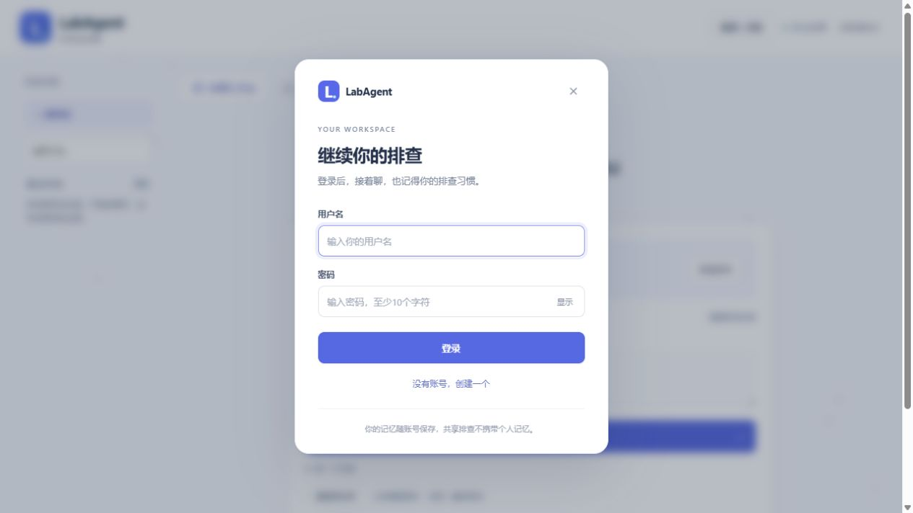

# LabAgent 零基础使用说明

适用版本：v0.19.6；更新于2026-11-19。

**没学过计算机网络，也可以先用自带示例体验项目。** 你暂时只需要知道：实验中有几台设备，设备之间可能通信失败；LabAgent 根据你交给它的材料分析原因，告诉你接下来检查什么，再根据新材料核对结果。

网站：[打开 LabAgent](https://labagent-15yh.onrender.com/)。第一次访问可能需要等待免费服务唤醒。本文按网站页面操作，不要求安装开发环境。

第一次使用按这条路线即可：**打开网站 → 登录个人账号 → 试一个示例 → 追问解释 → 核对复测 → 保存报告**。想体验再决定是否注册，也可以先试示例；个人账号用于保存你自己的新对话和记忆。

## 1. 先认识几个词，用到时再回来查

| 词语 | 可以怎样理解 | 在网站里有什么用 |
| --- | --- | --- |
| 设备 / PC | 网络里的电脑等设备；PC1、PC2 是实验中的名字 | 区分是谁出了问题 |
| 路由器 / R1、R2 | 帮数据选择去往其他网络的道路；R1、R2 是设备名字 | 排查数据在哪一段走不通 |
| IP 地址 | 网络中用来定位设备接口的地址，例如 `192.168.1.10` | 判断“谁要访问谁” |
| 接口 | 设备连接网络的端口，可以有自己的地址 | 确认连接位置和端口配置 |
| 网关 | 电脑去其他网络时，通常先交给它转发 | 检查第一步有没有走对 |
| Ping | 发送少量测试包，看目标是否回应 | 判断一次测试中的基本可达性；成功不代表全部实验要求完成 |
| 路由 / 路由表 | 设备保存的“去某个目标网络该往哪里走”的记录 | 查看转发方向和道路来源 |
| 静态路由 | 人工指定的一条转发路线 | 可能让 Ping 恢复，但未必满足要求使用 OSPF 的实验 |
| OSPF | 路由器之间交流网络信息、学习路线的一种协议 | 某些实验要求它正确建立邻接并学习路由 |
| Area / 区域 | OSPF 用来组织网络的分区 | 配置不符合要求时，可能影响协议运行 |
| 邻居 / 邻接 | 两台路由器在协议中发现彼此、建立交流关系 | 看 OSPF 是否正常建立关系；仍需结合其他输出 |
| 拓扑 / 网络地图 | 设备和连接关系的示意图 | 看清谁连谁、数据可能怎么走 |
| 配置 | 设备上的设置 | 说明“设备被设置成什么样” |
| 日志 / 命令输出 | 设备运行或检查时显示的文字 | 说明“刚才实际发生了什么” |
| 复测 | 修改之后，再检查一次并保存新结果 | 判断修改有没有生效 |
| 原文依据 / 引用 | 回答所依据的材料位置 | 点开核对系统有没有看错 |
| 知识库 / RAG | 回答前从导入的课程笔记中找相关内容 | 为分析提供有出处的知识参考 |

一个方便理解的例子：PC1 要访问 PC2，途中经过 R1 和 R2。Ping 是一次“发消息看看能不能收到回应”；路由表说明转发方向；OSPF 是路由器学习路线的方式。实验可能同时要求“消息能到”和“路线由 OSPF 学到”。

## 2. 第一次体验：不用准备自己的实验材料

### 第一步：打开网站

1. 打开网站，等待服务连接完成。
2. 如果浏览器要求网站访问用户名和口令，使用团队已有的网站访问凭据。这与右上角的个人账号、华为云账号是不同的入口；个人账号在进入网站后创建。
3. 首页主要看“实验材料”和“诊断与交流”，其他功能可以稍后再看。手机屏幕较窄时向下滚动查看。
4. 右上角显示 **“华为云诊断”** 时，表示当前使用云端诊断入口；本地运行可能显示“服务已就绪”。若提示等待配置，先联系维护人员，不需要自己去云平台开通资源。
5. 建议从 **“登录 / 记忆”** 创建个人账号后再开始新排查。具体步骤和截图见[第7节](#7-历史对话和个人记忆怎么用)。

### 第二步：先看一个已有真实运行结果的案例

1. 展开 **“试一个示例”**。
2. 选择 **“B 组实测：Ping 通了，OSPF 还没好”**。
3. 点击 **“带入实际运行对照”**。
4. 在结果区域的 **“复测与回放”** 查看各阶段的目标完成情况。
5. 展开 **“查看实际检查依据”**，能看到支持结论的原始输出；展开 **“查看配置改动”**，可以比较前后设置。

这一步载入已有 FRRouting 实测记录，由工具重新核对，尚未要求你配置真实设备。先看懂这个区别即可：**Ping 能通，说明这次基本通信测试成功；实验要求使用 OSPF 时，还要看协议和路由来源是否符合要求。**

这些记录来自 FRRouting 实验环境。它和华为 VRP 是不同的软件／设备环境，具体命令写法可能不同。

### 第三步：让系统解释你看到的结果

1. 点击 **“开始诊断”**，等待分析返回。
2. 在“诊断与交流”里读回复，先关注“发生了什么”和“还差什么”。
3. 在追问框中输入下面这句话，按 Enter 发送：

```text
我没学过计算机网络。请用这个示例说明：Ping 通了为什么还不算完成 OSPF 实验？
先解释概念，再指出材料中能证明这个结论的位置，不要一开始给我一大段命令。
```

4. 点击回复里的依据，核对解释对应哪份材料、哪段输出。

这一轮你应能说清：材料是什么、系统检查了什么、为什么“能通信”和“完成实验要求”有区别。不必先背命令。

## 3. 体验完整流程：故障 → 修改 → 复测

上一节适合看真实对照；这一节用内置合成示例体验逐步补充材料。这里切换的是准备好的示例记录，不会替你更改设备。

| 步骤 | 点击或输入 | 应关注什么 |
| --- | --- | --- |
| 1 | 点击“新的排查”或历史栏的“＋ 新对话” | 开始独立案例，避免混入上个案例 |
| 2 | “试一个示例”选择“OSPF：连通性与实验目标” | 本例要求同时检查通信和 OSPF 目标 |
| 3 | 点击“① 带入故障材料”，再点“开始诊断” | 观察故障现象、依据、下一步 |
| 4 | 点击“解释一下原因”，或自己追问 | 要求用简单语言解释区域、邻接、路由 |
| 5 | 点击“② 带入静态路由复测”，再点“核对修改结果” | 看连通性改善后，哪些 OSPF 要求仍没通过 |
| 6 | 点击“③ 带入OSPF修复材料”，再点“核对修改结果” | 查看新材料是否支持各项目标通过 |
| 7 | 点击“保存实验报告” | 下载并检查最终状态和修改过程 |

示例按钮有时会随分析状态暂时不可用，等本轮处理结束后继续。不要在步骤5、6之间新建对话，这样才能比较同一实验的变化。

## 4. 使用你自己的截图或日志

### 先交哪些材料

第一次不需要准备得很完美。建议至少交：**实验要做什么、哪里不正常、当时的截图或文字输出**。如果知道设备名字和地址，一起提供。

| 你手头有什么 | 放在哪里 |
| --- | --- |
| 报错截图 | 点击“添加材料”、拖进上传区，或 Ctrl+V 粘贴截图 |
| 配置／日志文件 | 点击“添加材料”，选择 `.txt`、`.cfg`、`.conf`、`.log` 等支持的文件 |
| 复制的终端文字 | 点击“直接粘贴内容”，粘贴后点“添加这份材料” |
| 实验说明 | 作为材料添加，并在“想解决什么？”里写清你要核对的目标 |
| 终端录屏 | 上传支持的录屏文件，识别完成后查看“复测与回放”中的操作时间线 |

截图识别后先检查设备名、IP 地址、数字和错误提示是否准确；看错的地方可以修正。当前截图上限20MB，录屏上限80MB且不超过10分钟；初次建议使用短录屏或清晰截图。

在 **“想解决什么？”** 中可以这样写：

```text
我没有学过计算机网络，请先用简单语言解释。
实验目标：让两台电脑互相访问，并按指导书使用 OSPF。
现在的现象：测试没有成功，截图和输出已上传。
请先说材料中能确认什么，再告诉我下一步需要补哪份输出。
如果需要运行命令，请写明在哪台设备、哪个界面运行，以及正常结果应该是什么。
```

不知道目标、设备或地址时直接说明“不清楚”，把指导书和现场材料交上来即可。

### 修改后怎样继续

1. 看回复中的操作建议；不理解就先问清设备、命令用途和预期结果。
2. **你或队友在自己的实验环境中执行修改与检查**。网站上的“给我修改步骤”会生成建议，设备实际结果需要重新提交。
3. 把修改后的新配置或输出补到当前对话。文件名建议保留设备名，补充说明这是哪次复测；更新同名材料时留意页面提示。
4. 点击 **“核对修改结果”**，或追问“这些是修改后的新输出，请比较上一轮并重新核对目标”。
5. 如果系统继续请求材料，按要求补充。问题解决后保存报告，并确认页面底部显示 **“已保存到云端”**。

新问题通常新建对话；同一个实验的追问、修改与复测留在原对话中。

发送后，消息会立即出现在对话中；“发送中”表示正在提交，“已发送”表示服务已收到。LabAgent 回复位置显示当前处理步骤与耗时，等待较久时会提示仍在处理或等待服务响应。可以先写下一条草稿，等本轮结束再发送；想了解实际步骤可展开“查看本轮处理进度”。失败时在原消息处点“重新发送”。上翻旧消息时，新回复不会强制把你拉到底部，可点“查看新回复”。

### “复测与回放”到底看什么

它是结果区域里与 **“分析与交流”** 并列的页签。可以理解为：聊天里解释原因，这里对照过程与证据。

| 你想知道什么 | 在这里怎么看 |
| --- | --- |
| 修改前后有没有改善 | 有实验运行对照记录时，查看“修复方案实际对照”中的各阶段、目标完成数和逐项结果 |
| 当时改了什么，凭什么说成功 | 展开“查看执行的修改命令”“查看配置改动”“查看实际检查依据” |
| 哪一步命令报错了，后来有没有重试 | 查看关键操作，展开“查看操作时间线”，沿顺序核对命令和报错 |
| 想回到出错时的画面 | 有对应录屏时点击时间点或“查看这个时间点”；跳转后可播放视频。只有文本日志时，点击会定位原文 |
| 看不懂某一步 | 点击关键操作旁的“分析这一步”，让系统结合材料解释 |

**不用准备材料也能试回放**：开始“新的排查” → 展开“试一个示例” → 选择 **“实验回放：找到未生效的命令”** → 点击“① 带入故障材料” → 等待自动打开“复测与回放” → 点击“播放回放”，或展开操作时间线并点击时间点。加载失败可点“重新加载回放”。该示例使用事先准备的合成演示视频；自己的实验录屏需自行录好后上传，网站不会自动录制屏幕。想进一步解释，再点“分析这一步”或“开始诊断”。

**想试修复对照**：按第2节选择“B 组实测：Ping 通了，OSPF 还没好”，点击“带入实际运行对照”，比较各阶段并展开原始输出。

打开后只有“把排查过程也留下来”的提示，通常是尚未添加可识别的操作日志、录屏或实验运行对照记录。普通问答、截图不一定带这些内容；日常修改后仍按上面的步骤补交新输出，点击 **“核对修改结果”**，到“分析与交流”查看更新后的实验目标即可。多阶段对照卡片需要配套实验运行记录。页签旁数字表示当前有内容的区域数量，不是复测次数。

## 5. 诊断结果先看什么

不必一口气展开全部细节，按这个顺序读：

1. **回复**：系统认为现在发生了什么，建议下一步做什么。
2. **材料依据**：点开原文或截图，看有没有引用错设备、旧配置或错误识别的文字。
3. **还需要这些材料**：说明目前缺什么，按提示补交。
4. **实验目标完成情况**：看哪些通过、哪些没通过或缺少证据。`3/7` 表示7项里3项满足，不是模型有几成把握。
5. **本轮工具记录**：想了解系统实际查了什么时再展开。

常见结果的含义：

| 页面表达 | 你可以怎样理解 |
| --- | --- |
| 可能原因、假设 | 是排查方向，下一步要用材料确认 |
| 需要补充材料 | 目前信息不足，继续提交要求的内容 |
| 用户反馈已恢复 | 用户说已经恢复；原始检查输出还要另外核对 |
| 观测核验通过／本轮测试通过 | 提交的测试输出满足当前检查条件，再看实验目标是否齐全 |
| 仅标题匹配 | 找到了标题相关的课程片段，正文未命中关键词；需要读原文确认是否有用 |
| 无匹配 | 当前资料里没查到词面匹配内容，可以换词、换资料范围或补充章节 |

## 6. 课程资料库怎么用

**实验材料**回答“我这次设备是什么情况”；**课程资料**回答“这类知识和实验规则是什么”。配置和报错放实验材料，讲义与知识笔记放课程资料库。

1. 点击首页 **“上传课程资料”**。
2. 读取 UTF-8 的 `.txt`／`.md`，或直接粘贴正文。PDF／Word 请先整理出文字。
3. 填写标题、来源、版本与归属范围。范围可以填 `my-course`，同一门课统一使用一个范围；它是资料分组名称。
4. 点击 **“保存资料”**。
5. 在 **“课程资料库”** 中选择范围，点击 **“用于当前排查”**。
6. 用 **“试查一个问题”** 检查是否能找到相关章节；试查本身不触发模型诊断。
7. 回到排查继续提问。已有回复不会因为换了资料就自动重写，需要再次发送问题。

你可以先导入队友整理的课程笔记。一次上传更多资料不一定让回答更准确，来源清楚、范围相关、原文完整更有帮助。

## 7. 历史对话和个人记忆怎么用

### 历史对话：继续某次实验

- 点击顶栏的 **侧栏小图标** 显示或隐藏历史对话，也可按 **Ctrl+B**（macOS 可用 Command+B）；展开后搜索或选择以前的排查，打开后可以继续问、补交材料。桌面会记住折叠状态，手机可点“收起”或遮罩关闭。
- 点击 **“＋ 新对话”** 开始独立问题。
- 对话旁的 **“删除”** 会要求确认。共享对话被删除后队友也无法再打开这段记录；需要保留时先下载报告。

### 个人记忆：让以后的回复更适合你

新版窗口如下。先看标题和两个输入框即可，下方链接可切换登录与注册。



| 你看到的账号或口令 | 用来做什么 |
| --- | --- |
| 进入网站时浏览器要求的团队访问凭据 | 打开目前的团队测试网站，向项目维护人员获取 |
| 页面右上角创建的个人账号 | 保存自己的新对话、记忆与排查偏好，每人分别注册 |
| 华为云／Supabase 的账号与密钥 | 维护部署和存储，由维护人员管理，日常使用不用填写 |

1. 点击右上角 **“登录 / 记忆”**。已有个人账号时，在“继续你的排查”窗口输入用户名和密码，点击 **“登录”**。
2. 没有个人账号，点击 **“没有账号，创建一个”**，窗口变为“创建你的工作区”。用户名3～32位，以字母开头，可包含数字及 `. _ -`；密码10～128个字符，昵称选填。按需要勾选“开启个人记忆”，再点 **“创建个人账号”**。
3. 密码框右侧 **“显示 / 隐藏”** 可以切换可见性。提交时显示“正在登录…”或“正在创建…”，等待结果即可；输入有误时窗口内会显示错误，可修改后重试。右上角 × 或 Esc 可以关闭窗口，关闭后密码输入会清空。
4. 登录成功后进入 **“我的记忆”**。展开 **“添加或编辑记忆”**，保存一条“排查偏好”：

```text
标题：计网零基础
内容：请先解释术语，再解释本次材料。需要操作时写明设备、界面、命令用途和预期结果，每次先给一个最关键的检查。
```

5. 开启记忆后，符合条件的个人诊断会记录问题主题。你可以编辑、删除、清空或关闭记忆；想查看保存范围，可展开 **“数据保存与共享范围”**。

历史对话保存一次排查过程；记忆保存之后仍可用的背景。记忆不会让过去的配置自动变成当前配置，也不会自动学会一套已经验证的修复方案。共享排查不使用个人记忆。

登录或退出账号后，页面会开始新的排查，避免沿用另一个身份的当前对话。以前保存的个人对话可登录原账号后从历史中打开。本地网站和公开网站各自保存账号；在本地注册的账号不会自动出现在公开站。

## 8. 网络地图与队友协作

暂时看不懂地图不影响开始诊断。已有材料后，可以点击 **“网络地图”**，查看设备关系和路径解释，点设备找对应材料。遇到看不懂的节点，可回对话问：“请沿地图解释 PC1 到 PC2 经过哪些设备，每一步为什么需要它。”

协作时：

1. 点击 **“团队协作”**，填写姓名与实验名称，点击 **“创建协作实验”**。
2. 点击 **“复制邀请链接”**，发给队友；队友打开后加入实验。
3. 补充材料后点 **“同步我的材料”**；收到更新时点 **“载入队友更新”**。
4. 分发具体检查任务，例如“请补充 R2 修改后的路由输出”。暂时不会操作时，可以负责上传截图、核对引用、整理报告。
5. 同一文件出现冲突时，先比较双方内容，再选择保留或合并，避免覆盖队友的新结果。

## 9. 保存、导出和常见问题

| 遇到的情况 | 怎么处理 |
| --- | --- |
| 首次打开很慢 | 等免费服务唤醒，页面连接完成后再操作 |
| 不知道说什么 | 先选“试一个示例”，或者直接说“我没学过计网，请逐步解释” |
| 缺少材料 | 看“还需要这些材料”；不知道如何获取就追问在哪台设备运行什么检查 |
| OCR 看错了地址 | 修正识别文字后再分析，必要时换清晰截图或复制终端文本 |
| 修改过但结果没变化 | 确认交的是修改后的新输出，再用当前对话核对；只说“改好了”无法核对实际结果 |
| 网络／模型请求失败 | 看对应内容区的错误，保留材料和草稿后重试 |
| 内置回放看不到或不播放 | 等示例载入后在“复测与回放”点“播放回放”；加载失败点“重新加载回放”，网站访问过期时刷新后重新输入团队口令 |
| 对话很多，想查看下面的详情 | 在对话区域滚动；到达顶部或底部后继续滚动，会带动整页 |
| 协作提示个人登录已过期 | 过期身份会清除；邀请共享操作可继续使用。读取自己的私人历史或记忆时需重新登录个人账号 |
| 按钮样式不完整，或仍看到旧登录窗口 | 先刷新；电脑上可按 Ctrl+F5 重新加载页面文件 |
| 个人登录提示用户名或密码不正确 | 核对个人账号，不要填写团队访问口令或华为云账号；同时确认打开的是注册时的本地站还是公开站 |
| 忘记个人密码 | 当前没有自助找回入口，联系网站维护人员处理 |
| 想保存自己的排查 | 点击“保存实验报告”，另外保留原始材料 |
| 担心重启后丢失 | 结束前看页面底部“已保存到云端”；尚未同步的修改仍依赖当前实例 |
| 看见“团队维护：工作区备份与恢复” | 这是维护人员的全站数据操作，普通使用不需要填写维护口令 |

本说明没有包含网站口令、个人密码或云端密钥。第一次体验无需你登录华为云或 Supabase。

### 想在自己电脑运行时

只使用公开站，可以跳过这一段。需要本地开发或演示时：

1. 电脑需已安装可运行的 Python。将仓库下载到电脑，双击项目根目录的 `setup.cmd`，等待依赖安装完成；首次环境配置不熟悉时可请队友协助。
2. 按 [README 的快速开始](../README.md#快速开始)，将 `.env.example` 复制为 `.env`，填写自己的模型配置。代码仓库不包含其他队员的密钥。
3. 双击 `start.cmd`，打开终端显示的本地地址，默认是 `http://127.0.0.1:8765/`。本地个人账号需单独创建。
4. 没配置模型时可以先看实测对照和课程试查；要使用模型诊断，请先完成模型配置。团队访问口令、云端专用凭据与 Supabase 备份由维护人员按部署需要另行配置。
5. 公开站“保存实验报告”会下载报告；本地默认把报告写入项目 `runtime/exports/`，若设置了数据目录，则在对应目录的 `exports/` 中，页面会提示保存位置。

## 10. 你可以怎样向别人介绍项目

> 我们做的是一个能持续对话的实验排查工具。用户上传截图、配置或日志，系统会读材料、查课程资料、调用检查工具，给出有原文依据的解释。用户修改后再上传新输出，系统继续核对实验目标，还能和队友分工检查，最后导出报告。一个典型区别是：Ping 恢复只证明这次基本通信测试成功，要求 OSPF 的实验还要继续检查协议和配置目标。

想进一步了解内部实现，可以阅读[功能与实现说明](功能与实现说明.md)。初次使用先完成第2、3节即可，其余功能按需尝试。
